# DT3D user manual

This manual explains how to create, edit, and view a Digital Twin 3D for Home Assistant (DT3D). It covers spaces, 3D objects, Home Assistant entities, floor-plan tools, measurements, grid configuration, viewports, visualization cards, and performance.

Complete the [setup guide](SETUP_GUIDE.md) before using this manual. For system architecture, source layout, and development instructions, see the [project README](README.md).

## Open the editor

Open the Home Assistant dashboard view that contains the DT3D editing card. A fullscreen **Panel (one card)** view gives the editor the most working space. The [setup guide](SETUP_GUIDE.md#create-the-fullscreen-editor) explains how to create and connect this card.

Keep one editing card for maintaining the digital twin and create separate read-only visualization cards for normal dashboard use.

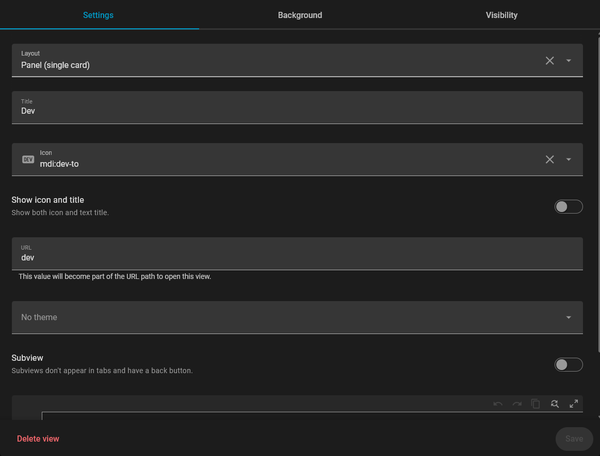

## Using the editor

### Navigate and edit objects

- The top bar manages spaces, the left icon rail contains creation tools and materials, and the right dock contains **Objects** and **Inspector**. Hover over an icon or focus it with the keyboard to see its label. Use the chevrons to hide or show either side panel.
- The bottom toolbar groups transform, measurement, grid, and collision controls. It wraps within the available workspace as the editor narrows. On small screens, close the object dock to return to the scene tools.
- Editing controls are dimmed and blocked while a space loads. The object dock explains the loading state; if loading fails, use **Retry loading space**. You can still switch spaces and open or close the side panels.
- Editor panels, inputs, tooltips, highlights, and buttons inherit the active Home Assistant theme, including its light or dark mode and custom accent color. Material preview backgrounds follow theme changes while the editor stays open.
- Orbit, pan, and zoom with the usual mouse or touch gestures. Use the camera button to switch between perspective and orthographic projection.
- Select an object with one click in the object tree or by double-clicking it in the scene. Use **Move**, **Rotate**, **Scale**, **Disable transform controls**, or **Focus selected objects** on the bottom toolbar. The inspector can edit the object's name, lock state, transform, geometry, material, shadows, and type-specific properties.
- In the object tree or while double-clicking objects in the scene, hold **Ctrl** (**Cmd** on macOS) to add or remove individual objects from the selection. In the tree, hold **Shift** to select a visible range. A shared transform control moves, rotates, or scales the selection together.
- Drag tree entries to reorder them or make them children of a group. Grouping is useful for floors, rooms, furniture, and entity-controlled layers. Moving or hiding a group also affects its children.
- Right-click an object in the tree or scene to move it to a point, clone it, or delete it. On a touch device, long-press the object. **Move to point** places the object at the next scene double-click; press **Escape** to cancel. The **Delete** key also deletes the selected object after confirmation.
- Use **Ctrl/Cmd+Z** to undo and **Ctrl/Cmd+Y** or **Ctrl/Cmd+Shift+Z** to redo editor changes.
- **Prevent object clipping** on the bottom settings toolbar stops translated objects from passing through visible mesh geometry and lets them slide along obstacles. This setting is stored in the current browser.
- Locked objects cannot be transformed or dragged. Unlock an object in its **Configuration** inspector section before editing it.

### Configure the grid and snapping

The bottom settings toolbar contains three grid controls:

- **Snap transforms to grid** (magnet) enables snapping. Translation uses the configured snap size, rotation snaps to 15-degree increments, and scale snaps to increments of 0.1. New wall points placed on ordinary surfaces and all manually drawn floor points also use the configured snap size; a direct wall connection stays on that wall's centerline.
- **Toggle grid** shows or hides the editor grid. Grid visibility does not enable or disable snapping.
- **Configure grid** opens the grid configuration dialog.

The grid configuration dialog provides:

| Setting   | Default | Description                                                                  |
| --------- | ------- | ---------------------------------------------------------------------------- |
| Grid size | `200`   | Base visible grid extent in meters. The grid expands as the camera rises.    |
| Snap size | `0.5`   | Translation, wall-placement, and manual floor-point snap interval in meters. |

Choose **Save** to apply the values. Grid size and snap size are stored in the current browser, not in the active space, so other devices can use different settings. Grid visibility and snapping are temporary toggles for the current editor.

### Manage spaces

A space is an independent scene with its own objects, saved viewports, daylight, tone mapping, and post-processing configuration. Use separate spaces for different homes, floors, or large sections of a home when one combined scene would be slow to load and render.

1. Use the selector at the top of the editor to switch spaces.
2. Select **Create space**, enter a name and optional description, and confirm. Use **Space configuration** (cog icon) in the same bar to edit those details later or make the active space the default. Selecting a new default clears the previous default.
3. To copy the active space, select **Clone space**, enter a name, and confirm. The new copy includes the space configuration, every object and its hierarchy, and uploaded geometry.
4. Add or edit objects; changes are synchronized to the backend automatically.
5. Select **Download space (.dt3d)** to save the active space as one portable file. The archive contains the space configuration and object database data, along with uploaded geometry, models, textures, and other persisted assets.
6. Select **Upload space (.dt3d)** to create and open a new space from an archive. Import generates new database IDs, so it does not overwrite the original space.
7. To remove the active space, use **Delete space** beside the selector and confirm. This permanently deletes every object in that space.

Space creation, cloning, import/export, switching, and deletion are hidden when `visualization_only: true`.

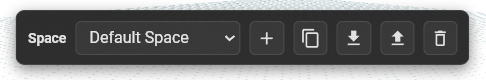

### Add 3D elements

The left icon rail groups the model and material libraries, scene creation tools, and floorplan tools. Hover over an icon to find a tool by name:

- **Model Library** is a searchable explorer with 3D preview thumbnails. Browse all models or select a category. Search matches model names, categories, and aliases such as “sofa” for Couch.
- Filter furniture by **Living Room**, **Dining Room**, **Kitchen**, **Bathroom**, **Master Bedroom**, **Children's Bedroom / Nursery**, **Home Office / Study**, **Laundry / Utility Room**, **Walk-in Closet / Dressing Room**, **Garage**, **Balcony / Terrace / Patio**, **Garden / Backyard**, **Entertainment / Game Room**, or **Home Gym / Fitness Room**, then browse the categories for that room.
- **Geometric Shapes** contains cube, sphere, plane, capsule, circle, cone, cylinder, dodecahedron, icosahedron, octahedron, ring, tetrahedron, torus, and torus knot.
- **Lighting** contains ambient, directional, point, spot, and rectangular area lights.
- **Doors, windows and gates** selects an opening placement tool; double-click a wall to place the chosen opening.
- **Scene tools** adds a Home Assistant entity, creates a group, or saves a viewport. **Floorplan** contains wall and floor drawing tools, wall creation settings, and the floorplan reference upload.
- Uploaded models: `.gltf`, `.glb`, `.obj`, `.fbx`, `.dae` (Collada), `.stl`, and `.3ds`. Models can also be dragged onto the canvas.
  - Use the file or folder upload buttons at the bottom of **Model Library**. Select or drop companion material and texture files with the model, or upload a folder to preserve their relative paths.
  - Prefer a self-contained `.glb` when possible for reliable results.

Selecting a model starts placement mode and displays **Double click on the space to place the object**. Move the pointer over the scene to see the model with a cyan outline, then double-click to confirm its position. The bottom of the model rests on the surface under the pointer, with the ground plane used in empty areas. Grid snapping also applies when enabled. Press **Escape** or right-click to cancel. The preview is added to the object tree and saved only after confirmation.

The same placement flow applies to selected Home Assistant entities and models imported through the file picker. When importing several models, place them one at a time. Dragging files directly onto the canvas uses the drop position.

After placement, edit dimensions, transform, material properties, or apply an image texture in the inspector. Keep imported geometry and texture sizes modest because they are downloaded and uploaded by each client.

The material library retains created materials even when no object uses them. Materials, textures, and image sources are stored separately in the database; objects reference materials by UUID. Removing an object or replacing a texture does not delete these assets. Use the material library's delete action to remove a material explicitly; its textures remain stored. Existing scenes migrate automatically when the updated add-on starts.

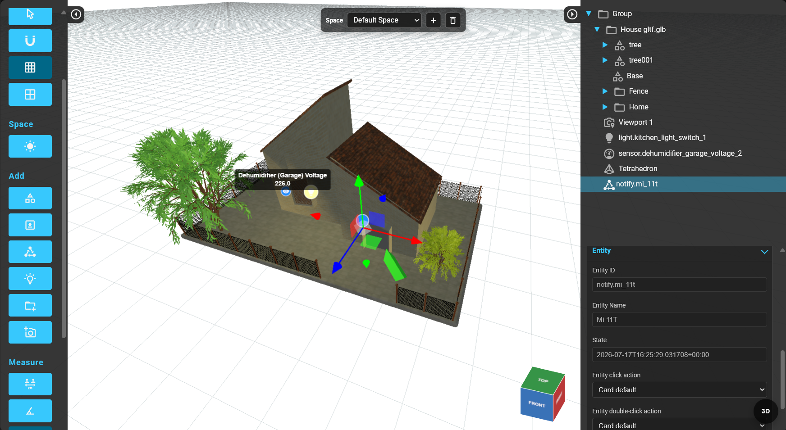

### Use the built-in furniture models

Open **Model Library**, select a furniture category, and choose a model. Move the outlined preview to the desired surface and double-click to place it. The transform controls and inspector can adjust it afterwards. All dimensions are in meters.

| Model   | Default size (W × D × H) | Model-specific controls                                            |
| ------- | ------------------------ | ------------------------------------------------------------------ |
| Table   | `1.60 × 0.80 × 0.75`     | Top thickness, leg thickness, and leg inset                        |
| Chair   | `0.48 × 0.52 × 0.90`     | Seat height/thickness, leg thickness, and back thickness           |
| Couch   | `2.10 × 0.90 × 0.85`     | Seat height, arm width, cushion thickness, and back thickness      |
| Bathtub | `1.70 × 0.75 × 0.60`     | Rim, wall, and base thickness                                      |
| Shelf   | `1.00 × 0.32 × 1.80`     | Board thickness, shelf count, and optional back panel              |
| Cabinet | `1.20 × 0.45 × 0.90`     | Board thickness, door count, interior shelf count, and handle size |
| Standing desk | `1.40 × 0.70 × 1.10` | Height, top thickness, column thickness, and leg inset |
| Wardrobe (with doors) | `1.50 × 0.60 × 2.10` | Board thickness, door count, interior shelf count, and handle size |
| Bed | `1.60 × 2.10 × 1.00` | Sleeping surface height, mattress thickness, board thickness, and optional headboard |
| Kitchen cabinet (top) | `1.20 × 0.35 × 0.70` | Board thickness, door count, interior shelf count, and handle size |
| Kitchen cabinet (bottom) | `1.20 × 0.60 × 0.90` | Board thickness, doors, shelves, handles, plinth height, and countertop thickness |

Expand the furniture-specific inspector section to change these construction parameters. The object rebuilds immediately while keeping its transform and material, so it can be resized without scaling every part manually.

Raise upper kitchen cabinets to the desired wall-mounting height using the position controls. Wardrobe and kitchen cabinet doors are modeled closed. Standing desk height can be changed for sitting or standing use.

### Living room collection

Open **Model Library**, choose **Living Room** in the room filter, and browse **Seating**, **Tables & Desks**, **Storage**, **Entertainment**, **Lighting**, and **Decoration**. Search also recognizes variant names such as “U-shaped sofa”, “bean bag”, “nesting tables”, and “wall shelves”.

Each library entry represents a customizable family. Choose the model, double-click its position in the scene, and open its furniture configuration in the inspector. Named presets load suitable starting dimensions; dimensions and construction details can then be edited independently. Undo restores the complete configuration, including dimensions changed by a preset. Variant choices are saved with the space and retained when cloning.

| Family | Variants and controls |
| --- | --- |
| Couch | Straight, left or right L-shaped, U-shaped sectional, or sofa bed; 2–8 main seats, return length and seats, arms, cushion dimensions, and extendable bed platform |
| Accent chairs | Armchair, recliner with optional extended footrest, lounge chair, or rocking chair; dimensions, seat height, arms, and recline angle |
| Ottoman / pouf / bean bag | Ottoman, pouf, or bean bag; dimensions, cushion shape, and tufting |
| Living room tables | Coffee, side, nesting, console, or corner presets; rectangular, rounded, round, oval, or triangular corner tops; square, tapered, pedestal, or trestle supports; leg count, inset, thickness, and 1–3 nested tables |
| Living room storage | TV cabinet, media console, bookshelf, display cabinet, sideboard, shelving unit, or wall shelves; dimensions, columns, shelves, doors, board thickness, back panel, and feet |
| TV | Dimensions, 16:9 / 21:9 / 4:3 screen, stand or wall mounting, and decorative screen state |
| Projector | Dimensions and tabletop or ceiling mounting with adjustable ceiling drop |
| Projection screen | Fixed, pull-down, or tripod construction with adjustable screen extension |
| Speakers / soundbar / cinema | Single speaker, soundbar, or 5.1 home cinema arrangement; cabinet dimensions, drivers, system spacing, and subwoofer |
| Living room lamps | Floor lamp, table lamp, pendant, or wall light; dimensions, tapered / drum / globe shade, on/off, brightness, and warm / neutral / cool white |
| Rug | Rectangular, rounded, round, or oval; dimensions, border, and optional fringe |
| Mirror | Rectangular, round, oval, or arched frame; dimensions, frame width, and optional floor stand |
| Indoor plant | Leafy plant, palm, or succulent; size, leaf count, and pot proportion |
| Vase | Bottle, cylinder, or bowl; dimensions and bottle neck proportion |
| Artwork | Abstract, landscape, or triptych; dimensions and frame width |
| Wall clock | Dimensions and displayed hour/minute |
| Fireplace | Mantel surround or glazed linear model; dimensions, decorative fire, and warm light intensity |
| Curtains | Dimensions, opening amount, pleats, one or two panels, and optional rod |

Lamp and fireplace light sources illuminate the scene. Primary material edits change the main finish while preserving detail finishes such as glass, metal feet, foliage, and screens. Nesting table dimensions describe the largest table; cinema spacing describes the complete arrangement. Position wall shelves, mirrors, artwork, curtains, screens, and mounted lighting at the desired installation height with the transform controls.

### Bathroom collection

Open **Model Library**, select **Bathroom** in the room filter, and browse **Sanitary fixtures**, **Washbasins**, **Bathing**, **Storage**, **Accessories**, and **Other**. The collection groups the requested objects into 11 customizable families. Search recognizes individual variants such as “wall-hung toilet”, “countertop basin”, “corner bathtub”, and “heated towel rail”.

Choose a family, position its outlined preview, and double-click to place it. Open its configuration section in the inspector to select a preset and adjust its dimensions and details. Presets load suitable starting dimensions; custom edits, cloning, saving, and undo work the same way as for living room models.

| Family | Variants and controls |
| --- | --- |
| Sanitary fixtures | Floor-mounted toilet, wall-hung toilet, bidet, or urinal; dimensions, seat height, optional toilet lid, and open/closed lid |
| Washbasins / vanity | Pedestal, wall-mounted, countertop, double basin, or vanity unit; dimensions, 1–2 bowls, bowl depth, taps, and vanity cabinet finish |
| Bathtub | Existing built-in model plus freestanding oval and corner variants; dimensions, wall/rim/base thickness, and taps |
| Showers | Tray, walk-in shower, or enclosure; dimensions, tray height, shower fittings, glass opacity, metal frame, and sliding door opening |
| Bathroom storage | Medicine cabinet, bathroom cabinet, tall cabinet, wall shelf, or under-sink cabinet; dimensions, shelves, doors, board thickness, feet, open/closed doors, and back panel |
| Mirror | Shared with the living room collection; rectangular, round, oval, or arched frame, dimensions, frame width, and optional stand |
| Towel rails | Standard bar or heated ladder rail; dimensions, crossbar count, optional towel, and heater indicator |
| Bathroom holders / hooks | Toilet paper holder, soap holder, or towel hooks; dimensions, hook count, and optional paper roll or soap |
| Laundry basket | Oval or rectangular, woven or slatted; dimensions, slat count, optional lid, and laundry contents |
| Bathroom stool | Rounded or round seat; dimensions, 3–4 legs, seat thickness, and non-slip feet |
| Bath mat | Uses the shared rug geometry with bathroom dimensions; rectangular, rounded, round, or oval, with optional border and fringe |

The fixtures have open bowl geometry. Shower glass remains translucent, and under-sink cabinets include a rear pipe cutout. Cabinet presets rebuild their corresponding doors, shelves, and supports. Dimensions describe the main fixture body; taps, open lids, handles, and other fittings can extend beyond it. Position wall-hung fixtures, wall basins, medicine cabinets, mirrors, shelves, rails, and hooks at the desired installation height using the transform controls.

### Dining room collection

Open **Model Library**, select **Dining Room**, and browse **Tables**, **Seating**, **Storage**, **Lighting**, and **Decoration**. Eight customizable families cover the 22 requested dining room objects. Search recognizes individual variants such as “extendable dining table”, “upholstered dining chair”, “china cabinet”, and “wine rack”.

Choose a family, move its outlined preview, and double-click to place it. Select a preset in its inspector configuration section, then adjust its dimensions and details. Presets load suitable starting dimensions; edits support saving, cloning, and undo.

| Family | Variants and controls |
| --- | --- |
| Dining tables | Rectangular, round, oval, square, or extendable; top shape, dimensions, thickness, support style, leg count and inset, and extension leaf length / extended state |
| Dining seating | Dining chair, upholstered chair, bench, or bar stool; dimensions, seat height and thickness, square / tapered / pedestal legs, upholstery, back slats, arms, and stool footrest |
| Dining storage | Sideboard, buffet, china cabinet, display cabinet, drinks cabinet, or wine rack; dimensions, columns, shelves, drawers, board thickness, feet, glass opacity, open doors, and optional dishes / bottles / stemware |
| Dining lighting | Chandelier, pendant, or wall light; dimensions, 1–10 lights, candle / globe / dome shade, on/off, total brightness, and warm / neutral / cool white |
| Rug, mirror, decorative plant | Shared existing models with the same shape, size, and detail controls across room collections |
| Centerpieces | Fruit bowl, floral arrangement, or candles on a tray; dimensions, item count, optional contents, and candle flames |

Dining light sources illuminate the scene; their brightness control describes the whole fixture. Extendable table width describes the closed table, with leaf length added while extended. Cabinet dimensions describe the closed body; opened doors and handles can extend beyond it. Move pendant/chandelier canopies, wall lights, and mirrors to their installation height with the transform controls. Place centerpieces on a tabletop using the placement preview or height control.

### Kitchen collection

Open **Model Library**, select **Kitchen**, and browse **Base cabinets**, **Wall cabinets**, **Tall cabinets**, **Countertops**, **Appliances**, **Fixtures**, **Furniture**, and **Accessories**. Seventeen customizable families cover all 41 requested objects. Search recognizes individual objects such as “corner wall cabinet”, “oven tower”, “U-shaped countertop”, “American-style refrigerator”, and “spice rack”.

Choose a family, move its outlined preview, and double-click to place it. Select the desired preset in the inspector, then adjust dimensions and details. The existing upper and lower cabinet identifiers and saved numeric settings are preserved. Tables and seating are shared with Dining Room; choose the bar stool or dining chair preset for kitchen seating.

| Family | Variants and controls |
| --- | --- |
| Base cabinets | Single, double, drawer, corner, or sink cabinet; dimensions, board thickness, doors, shelves, handles, plinth, optional countertop, open fronts, and drawer count |
| Wall cabinets | Single, double, corner, or open shelving; dimensions, board thickness, doors, shelves, handles, back panel, and open doors |
| Tall cabinets | Pantry, oven tower, fridge housing, or broom cabinet; dimensions, shelves, board thickness, open doors, and optional broom |
| Countertops / islands / bars | Straight, L, U, island, peninsula, or breakfast bar; dimensions, top thickness, arm depth, overhang, supports, backsplash, and sink / hob openings |
| Refrigeration | Refrigerator, American-style refrigerator, or upright freezer; dimensions, shelves, open doors, and optional dispenser |
| Ovens / microwaves | Oven or microwave; dimensions, opening door, and power indicator |
| Hobs / extractor hood | Induction or gas hob with 1–6 zones; chimney or box hood; dimensions and visual power / lamp indicators |
| Cleaning appliances | Dishwasher or washing machine; dimensions, opening door, and power indicator |
| Coffee machines | Espresso or pod machine; dimensions, optional cup, and power indicator |
| Kitchen sinks / faucet / bin | Single or double hollow sink with optional faucet; separate gooseneck or straight faucet with reach extension; round or rectangular bin with opening lid and optional pedal |
| Kitchen trolley | Dimensions, shelves, four optional casters, and optional handle |
| Kitchen racks / shelves | Dish rack, spice rack, or wall shelves; dimensions, tier count, contents count, and optional plates / jars |

Worktop height is the top surface; island/bar height includes the supporting furniture. L/U dimensions describe the full footprint and arm depth controls each run. Worktop cutouts are real openings. Sink height describes the bowl from its underside to its rim; raise it so the rim meets the worktop. Faucets and open doors extend beyond the closed body dimensions. Move wall cabinets, shelves, hoods, and other mounted objects to their installation height using the position controls. Appliance indicators show visual state and do not simulate appliance operation.

### Master bedroom collection

Open **Model Library**, select **Master Bedroom**, and browse **Beds**, **Bedside**, **Storage**, **Seating**, **Other furniture**, and **Decoration**. Fourteen customizable families cover all 29 requested objects. Search recognizes individual items such as “super king bed”, “sliding doors”, “tallboy”, “full-length mirror”, and “floor lamp”.

Choose a family, move its outlined preview, and double-click to place it. Select presets and customize the model in the inspector. Existing bed and wardrobe creation identifiers and saved numeric settings are preserved. Seating, rugs, curtains, artwork, floor lamps, and mirrors use the existing shared models.

| Family | Variants and controls |
| --- | --- |
| Beds | Single, double, queen, king, or super king starting dimensions, independently combined with standard, platform, storage, or adjustable frames; mattress and frame dimensions, headboard, padding, bedding, storage drawers, and head / foot angles |
| Bedside tables / shelves | Standing table or floating shelf; dimensions, drawers, opening amount, feet, and open cubby |
| Bedside lamp | Shared lamp construction with table-lamp defaults; dimensions, shade style, on/off, brightness, and light color |
| Wardrobe | 2-door, 3-door, or sliding presets; dimensions, doors, shelves, board and handle size, hinged door opening, sliding opening, hanging compartment, and mirrored doors |
| Chests / dressers / clothes racks | Chest of drawers, wide dresser, tallboy, or clothes rack; dimensions, drawer columns / rows / extension, handles, legs, hangers, and shoe shelf |
| Bedroom bench | Dimensions, padded seat, optional hollow storage, and lifting seat |
| Accent chairs / ottomans | Shared configurable seating from the living room collection |
| Dressing tables / vanities / desks | Dressing table, vanity, or desk; dimensions, drawers, opening amount, optional oval / rectangular mirror, mirror height, and illuminated vanity bulbs |
| Full-length mirror | Shared mirror with a full-length size preset, shape, frame width, dimensions, and optional stand |
| Decoration | Shared rug, curtains, wall art, and floor lamp with their existing controls |

Bed sizes are editable starting dimensions and describe the outer frame. Bed height describes the headboard; mattress surface height has its own control. Raised adjustable sections can extend above the headboard. Dressing furniture height describes the tabletop, with the mirror extending above it. Open drawers and doors extend beyond closed body dimensions. Position floating bedside shelves, mirrors, artwork, curtains, and mounted lamps at the desired installation height using the position controls.

### Children's bedroom / nursery collection

Open **Model Library**, select **Children's Bedroom / Nursery**, and browse **Beds**, **Storage**, **Furniture**, **Play**, and **Decoration**. Fourteen customizable families cover all 27 requested objects. Search recognizes names such as “cot”, “loft bed”, “toy chest”, “nursing chair”, “kids' desk”, “indoor tent”, and “night light”.

Choose a family, move its outlined preview, and double-click to place it. Use its inspector configuration section to select a preset and adjust dimensions and details. Preset edits, cloning, saving, and undo use the same workflow as the other room collections.

| Family | Variants and controls |
| --- | --- |
| Children's beds / cribs | Crib, cot, toddler, single, bunk, loft, trundle, or cabin bed; dimensions, mattress height and thickness, side rails, crib slats, ladder rungs / side, trundle extension, and optional loft desk |
| Children's storage | Wardrobe, toy chest, toy storage unit, bookshelf, or chest of drawers; dimensions, compartments, shelf / drawer rows, opening lid / doors / drawers, and optional books / bins / toy blocks |
| Changing table | Dimensions, drawers and opening amount, optional changing pad, and lower storage shelf |
| Nursing / rocking chairs | Shared padded chair construction; nursing or rocking preset, dimensions, seat height, back angle, and arms |
| Kids' desks / play tables | Desk or play table; dimensions, round / rounded top, top thickness, drawer and opening amount, and optional lower shelf |
| Kids' chair | Dimensions, seat height, back slats, and optional arms |
| Play mat | Dimensions, colored puzzle tile rows / columns, and joining tabs |
| Playpen | Dimensions, slats per panel, opening front gate, and optional padded floor |
| Indoor tent | Dimensions, real entrance opening, floor mat, and wooden poles |
| Toy kitchen | Dimensions, hollow sink, opening oven, faucet, and wall shelf |
| Climbing structures | Triangle ladder or climbing arch; dimensions, rung count, colored rungs, and optional ramp |
| Night lights | Star or cloud shape; dimensions, on/off, brightness, and warm white / soft blue / soft pink illumination |
| Wall shelves / rug | Configurable children's shelf tiers with brackets / back rails; shared rug geometry and controls |

Bed dimensions describe the frame. Mattress height controls the main sleeping level; bunk beds add a second lower mattress, loft beds can include a desk, cabin beds include storage fronts, and trundle beds slide sideways. Crib and cot models use a plain mattress without pillows or covers. Opening drawers, lids, gates, oven doors, trundles, and ramps can extend beyond the closed footprint. Position wall shelves at their installation height using the position controls. Changing pads and top rails can extend above the changing-table surface height.

### Home office / study collection

Open **Model Library**, select **Home Office / Study**, and browse **Desks**, **Seating**, **Storage**, **Equipment**, **Accessories**, and **Other**. Fourteen customizable families cover all 27 requested objects. Search recognizes “L-shaped desk”, “ergonomic chair”, “filing cabinet”, “monitor”, “scanner”, “noticeboard”, and the other individual model names.

Choose a family, move its outlined preview, and double-click to place it. Select presets and customize the object in its inspector configuration section. The existing standing desk keeps its identifier and saved settings. Sofa and lounge-chair models are shared with the living room collection and appear under **Other**.

| Family | Variants and controls |
| --- | --- |
| Office desks | Writing, computer, L-shaped, corner, or executive; dimensions, top thickness, left / right return and run depth, cable opening, keyboard tray / extension, and optional drawer pedestals |
| Standing desk | Existing height-adjustable desk with its width, depth, height, top thickness, and leg controls |
| Office seating | Office, ergonomic, visitor, or stool; dimensions, seat height, back angle, arms, ergonomic headrest / mesh back, and optional caster base |
| Office storage | Filing cabinet, bookshelf, drawer unit, storage cabinet, or wall shelving; dimensions, compartments, drawers / shelves, opening drawers / doors, optional binders, and casters |
| Desktop computers | Tower or all-in-one; dimensions, screen / power state, and optional keyboard |
| Monitors | Dimensions, 1–3 monitors, spacing, tilt, and screen state |
| Laptops | Closed body dimensions, opening lid / angle, and screen state |
| Printers / scanners | Printer or flatbed scanner; dimensions, opening scanner lid, optional paper, and power indicator |
| Desk lamps | Dimensions, arm reach, head tilt, on/off, brightness, and warm / neutral / cool white illumination |
| Monitor stands | Dimensions and optional opening drawer |
| Whiteboards / noticeboards | Dimensions, notes / marks, optional floor stand, and whiteboard marker tray |
| Meeting tables / sofas / lounge chairs | Configurable meeting-table top and supports, plus the existing sofa and accent-chair families |

L/corner desk dimensions describe the full footprint. L desk run depth controls both arms, and the return can be mirrored. Keyboard trays, drawers, open lids, lamp arms, and board stands can extend beyond the closed body dimensions. Monitor dimensions describe each monitor; multiple monitors increase the arrangement's total width. Laptop dimensions describe the closed body; the open screen extends above it. Board dimensions describe the board itself, with any floor stand extending below it. Place equipment, lamps, and monitor stands on the desktop using the placement preview, and set wall shelving / boards to their installation height with the position controls.

### Laundry / utility room collection

Open **Model Library**, select **Laundry / Utility Room**, and browse **Appliances**, **Fixtures**, **Storage**, **Furniture**, and **Accessories**. Eight customizable families cover all 16 requested objects. Search recognizes names such as “washer-dryer”, “stacked laundry unit”, “laundry basin”, “broom cupboard”, “ironing board”, and “clothes drying rack”.

Choose a family, move its outlined preview, and double-click to place it. Select presets and adjust dimensions and details in the inspector. Preset changes, cloning, saving, and undo use the same workflow as other collections. The laundry basket is shared with Bathroom and appears under **Accessories** in this room.

| Family | Variants and controls |
| --- | --- |
| Laundry appliances | Washing machine, tumble dryer, washer-dryer, or stacked unit; dimensions, opening doors, left / right hinges, drum contents, and power indicators |
| Utility sinks / laundry basins | Freestanding utility sink or unmounted laundry basin; dimensions, bowl depth, optional stand, drainpipe / trap, and faucet |
| Laundry storage | Laundry cabinet, broom cupboard, wall shelves, or storage rack; dimensions, shelves, doors and opening state, back panel, and optional broom / storage boxes |
| Folding tables / ironing boards | Laundry folding surface or tapered ironing board; dimensions, top thickness, collapsing legs, and optional iron rest |
| Sorting stations | Dimensions, 1–4 separate bags, pull-out amount, optional folding top, contents, and casters |
| Clothes drying racks | Winged airer or tower rack; dimensions, rods per panel, tower tiers, folding state, optional wings, and towels |
| Laundry basket | Shared oval / rectangular basket with woven / slatted sides, optional lid, and laundry contents |
| Cleaning trolleys | Dimensions, shelves, casters, hollow bucket and bottles, and optional mop |

Stacked appliance dimensions describe the complete unit. Sink height includes any stand and ends at the rim; faucets can extend above it. Without a stand, basin dimensions describe the bowl body. Table height describes the unfolded surface; folding the legs lowers the model into a compact horizontal profile. Drying racks fold their panels upright and narrow their frame. Open doors, pulled-out bags, iron rests, handles, towels, and supplies can extend beyond the main body. Position wall shelves and unmounted basins at their installation height with the position controls. Appliance displays show visual power state and do not simulate laundry cycles.

### Walk-in closet / dressing room collection

Open **Model Library**, select **Walk-in Closet / Dressing Room**, and browse **Wardrobes**, **Storage**, **Furniture**, and **Accessories**. Eight customizable families cover all 16 requested objects. Search recognizes each object name, including “modular wardrobe”, “shoe rack”, “accessories organizer”, “vanity table”, and “illuminated mirror”.

Choose a family, move its outlined preview, and double-click to place it. Use the inspector to select a preset and adjust its dimensions and details. Configurations support saving, cloning, and undo. Vanities, ottomans, and benches share their existing models with the bedroom and living room collections.

| Family | Variants and controls |
| --- | --- |
| Dressing room wardrobes | Open, closed, modular, or corner wardrobe; dimensions, 1–6 bays, shelves, drawers and extension, hinged doors and opening state, hanging compartments, garment count, and back panel |
| Closet storage / organizers | Shoe rack, drawer unit, hanging rail, shelving unit, or accessories organizer; shelf count and tilt, drawer rows and extension, compartment rows / columns, optional contents, and glass organizer cover |
| Dressing island | Dimensions, drawer columns and rows, extension, drawers on one or both sides, solid or transparent glass top, and optional recessed tray dividers |
| Dressing tables / vanities | Shared dressing table, vanity, or desk; dimensions, drawer rows and extension, optional mirror, mirror shape / height, and bulbs |
| Ottomans | Shared ottoman, pouf, or bean bag; dimensions, shape, and tufting |
| Benches | Shared upholstered or storage bench; dimensions, cushion, seat thickness, and opening storage lid |
| Dressing mirrors | Full-length or illuminated mirror; dimensions, rectangular / round / oval / arched frame, frame width, stand, LED border, light switch, brightness, and light color |
| Clothes stands | Valet stand or coat tree; dimensions, hook count, optional clothing, and valet shoe shelf |

Corner wardrobe width and depth describe the full L-shaped footprint. Set the return side and cabinet run depth to fit the room; bay count applies separately to each run. Shelves occupy bays without hanging rails. Drawer extensions, open doors, handles, mirror stands, and clothing can extend beyond the main body. The island's glass top reveals a recessed accessory tray. Move wall mirrors to their installation height with the position controls. Mirror illumination provides a visible LED border and a local scene light.

### Garage collection

Open **Model Library**, select **Garage**, and browse **Vehicles**, **Storage**, **Work area**, **Equipment**, and **Other**. Nine customizable families cover all 18 requested objects. Search recognizes individual objects such as “motorcycle”, “wall storage rack”, “tire rack”, “tool pegboard”, “pressure washer”, and “storage boxes”.

Choose a family, move its outlined preview to the desired position, and double-click to place it. Select presets and adjust dimensions and accessories in the inspector. Configurations support saving, cloning, and undo.

| Family | Variants and controls |
| --- | --- |
| Cars | Sedan, hatchback, or SUV; dimensions, wheelbase, front wheel steering angle, illuminated light finishes, and optional roof rack |
| Motorcycles / bicycles / scooters | Three distinct frame presets; dimensions, wheel radius, spokes, saddle / seat, and kickstand |
| Garage storage / racks | Garage shelving, tool cabinet, wall storage rack, bike rack, or tire rack; dimensions, rack levels, drawer count and extension, rack slots / hooks, contents, and tool cabinet casters |
| Workbenches / workshop tables | Dimensions, worktop thickness, drawer rows and extension, lower shelf, optional supported pegboard, board height, tools, and bench vice |
| Tool pegboard | Dimensions, hole rows / columns, and hanging tool count; perforations pass through the board |
| EV charger | Body dimensions, wall or pedestal mounting, stand height, cable loops and reach, docked / extended plug, and power indicator |
| Compressors / pressure washers | Two equipment presets; dimensions, optional hose, coil size, gun / lance, and power indicator |
| Recycling / waste bins | Color-coded recycling group or waste bin; overall dimensions, 1–4 bins, opening lids, hollow interiors, and optional rear wheels |
| Storage boxes | Plastic tote, cardboard box, or wooden crate; dimensions per box, 1–4 stacked boxes, handles, lids, and opening top lid |

Vehicle depth describes length along the vehicle. Wheel radii are limited to fit the selected dimensions. Workbench height ends at the work surface; pegboards and the vice extend above it. Charger height describes the body; pedestal height is added below it. Bin width describes the complete group, while storage box height applies to each box in the stack. Open lids, extended drawers, cables, handles, and accessories can extend beyond the main body. Move wall-mounted chargers, wall racks, and pegboards to their installation height with the position controls. Equipment indicators show their configured visual power state.

### Balcony / terrace / patio collection

Open **Model Library**, select **Balcony / Terrace / Patio**, and browse **Seating**, **Tables**, **Cooking**, **Shade**, **Decoration**, and **Other**. Fifteen customizable families cover all 24 requested objects. Search recognizes individual names such as “outdoor sectional sofa”, “hanging chair”, “bistro table”, “pizza oven”, “retractable awning”, and “raised garden bed”. The outdoor rug shares the existing rug model and its shape, border, and fringe controls.

Choose a family, move its outlined preview, and double-click to place it. Select presets and adjust dimensions and details in the inspector. Configurations support saving, cloning, and undo.

| Family | Variants and controls |
| --- | --- |
| Outdoor chairs / loungers | Outdoor chair, lounge chair, or sun lounger; dimensions, seat height, back recline, slats, cushions, and armrests |
| Outdoor sofas / sectionals | Straight, left / right L-shaped, or U-shaped; dimensions, main seats, seats per return, total return depth, cushions, and armrests |
| Hammocks / hanging chairs | Sagging fabric hammock or ribbed hanging chair; dimensions, optional stand, hammock sag, chair ribs, and cushions |
| Outdoor tables | Dining, coffee, side, or bistro table; dimensions, rectangular / round / oval tops, solid or separate slats, slat count, top thickness, and four legs / trestles / pedestal |
| Barbecue grill | Gas or kettle grill; dimensions, hinged lid, gas control knobs, side shelves, and visible fire |
| Outdoor kitchen | Dimensions, cabinet modules and opening doors, recessed sink with faucet, and optional cooking grate |
| Pizza oven | Arched oven with open mouth and baking stone; body dimensions, optional stand and its height, removable door, and visible fire |
| Parasol | Center pole or cantilever; dimensions, open / folded canopy, tilt, and rib count |
| Pergola | Freestanding or wall-mounted; dimensions, roof slats and angle, fabric roof, and optional curtains with gathering control |
| Retractable awning | Dimensions, extension, pitch, articulated arm count, and striped or plain fabric |
| Planters / garden beds | Rectangular planter, flower pot, or raised garden bed; container dimensions, flowers / foliage / empty, plant count, soil fill level, and optional legs |
| Rug | Shared rug with rectangular / rounded / round / oval shape, border, and fringe |
| Hot tub | Square or round basin; dimensions, transparent water and fill level, jets, steps, and protective cover |
| Fire pit | Fire bowl or fire table; dimensions, visible flames, local light brightness, and protective cover |
| Outdoor heater | Mushroom reflector or pyramid; dimensions, guard rods, illuminated element, and local light brightness |

Furniture dimensions describe the main frame; reclining backs, sectional returns, open lids, side shelves, steps, plants, and accessories can extend beyond it. Sectional return depth includes the main sofa depth. Planter height describes the container, with plants above it. Pizza oven height describes the body; the stand and chimney extend beyond it. Awning depth describes its fully extended fabric length; extension and pitch change its occupied space. Position wall-mounted awnings, pergolas, and suspended seats without stands at their installation height with the position controls. Closing a fire pit cover hides the flames and turns off its local light.

### Garden / backyard collection

Open **Model Library**, select **Garden / Backyard**, and browse **Furniture**, **Recreation**, **Landscaping**, **Structures**, and **Equipment**. Fifteen customizable families cover all 24 requested objects. Search recognizes names such as “picnic table”, “outdoor dining set”, “swing set”, “flower bed”, “garden path”, “greenhouse”, and “rainwater tank”.

Choose a family, move its outlined preview, and double-click to place it. Select presets and adjust dimensions and details in the inspector. Configurations support saving, cloning, and undo. Planters, pergolas, and suspended seating share their existing models with the patio collection. For a swing chair, select the **Hanging chair** preset in the suspended seating controls.

| Family | Variants and controls |
| --- | --- |
| Picnic tables / benches / dining sets | Integrated picnic seating, slatted garden bench, or table with chairs; dimensions, tabletop slats, bench backrest, number of side chairs, and optional end chairs |
| Hammocks / hanging chairs | Shared suspended seat with hammock / hanging chair presets, stand, sag, ribs, and cushions |
| Swimming pool | Rectangular or round basin; dimensions, transparent water and level, ladder, and optional internal steps in rectangular pools |
| Trampoline | Dimensions, frame supports, springs, safety net with poles, and ladder |
| Swing set | Dimensions, 1–4 seats, and swing angle; seats and suspension move together |
| Garden slide | Straight or wavy chute; dimensions, ladder rungs, platform, raised edges, and optional handrails |
| Sandbox | Dimensions, sand fill level, benches, buckets, and protective cover |
| Garden playhouse | Dimensions, pitched roof height, opening door, windows, floor, and optional front porch |
| Trees / shrubs | Broadleaf tree, conifer, or shrub; dimensions, trunk proportion, branch / foliage cluster count, green / autumn foliage, and bare branches |
| Planters / garden beds | Shared planter family with a new low flower-bed preset; container dimensions, flowers / foliage / empty, plant count, soil level, and optional legs |
| Garden path | Paving slabs, stepping stones, or gravel; dimensions, rows, columns, gaps, sideways bend, and edging |
| Fountains / ponds | Tiered fountain or low pond; dimensions, water, pump / stream count, pond border stones, and lilies |
| Pergola | Shared freestanding / wall-mounted structure with adjustable roof slats or fabric, and optional curtains |
| Sheds / greenhouses / gazebos | Garden shed, transparent greenhouse, or open gazebo; dimensions, roof height, opening door, windows, floor, and gazebo side count |
| Compost / rainwater / mower storage | Slatted compost bin, hollow rainwater tank, or mower storage cabinet; dimensions, slats / tank ribs, opening lid, compost access hatch, mower doors, contents, and tank tap |

Dining-set dimensions describe the table; chairs extend beyond its footprint. Pool dimensions describe the basin, with the ladder outside it. Trampoline height includes its safety net; disabling the net leaves a lower jumping frame. Plant and tree dimensions describe their procedural form, while planter dimensions describe the container with planting above it. Building height includes the roof. Porches, roof overhangs, open doors and lids, taps, downpipes, and accessories can extend beyond the main body. Use the position controls to adjust installation height where needed.

### Entertainment / game room collection

Open **Model Library**, select **Entertainment / Game Room**, and browse **Seating**, **Gaming**, **Tables**, **Entertainment**, and **Storage**. Fourteen customizable families cover all 18 requested objects. Search recognizes names such as “gaming chair”, “arcade machine”, “racing simulator”, “foosball table”, “ping-pong table”, and “game storage cabinet”.

Choose a family, move its outlined preview, and double-click to place it. Use the inspector to select presets and adjust dimensions and accessories. Configurations support saving, cloning, and undo. Sofas, recliners, bean bags, TVs, projectors, screens, and speakers share their existing models with the other room collections. Select **Recliner** in the accent-chair family or **Bean bag** in the ottoman family for those requested variants.

| Family | Variants and controls |
| --- | --- |
| Gaming chair | Dimensions, seat height, recline, accent color, bolsters and support pillows, armrests, caster base, and optional extended footrest |
| Sofa | Shared couch with straight / L / U layouts, seats, return dimensions, arms, cushions, and sofa-bed options |
| Recliner | Shared accent-chair family with a recliner preset, adjustable back, armrests, and extended footrest |
| Bean bag | Shared ottoman family with bean-bag, pouf, and ottoman presets |
| Gaming desk | Straight or mirrored L-shaped desktop; dimensions, return depth, cable port, 0–3 monitors, PC tower, keyboard / mouse, and edge lighting |
| Arcade machine | Upright or bartop cabinet; dimensions, 1–2 control stations, buttons per player, screen power, and marquee light |
| Gaming console | Flat console, tower, or handheld; dimensions, 0–4 separate gamepads, and screen / indicator power |
| Racing simulator | Dimensions, bucket seat and slide, steering wheel angle, pedal board angle, 0–3 monitors, accent trim, and gear shifter |
| Game tables | Pool, foosball, ping-pong, or poker table; dimensions, surface color, accessories, pool-pocket radius, foosball rod angle, ping-pong folding, and poker place count |
| TV | Shared television with dimensions, aspect ratio, optional stand, and screen power |
| Projector | Shared projector with dimensions, tabletop / ceiling mounting, and mount drop |
| Projection screen | Shared fixed, pull-down, or tripod screen with dimensions and deployment |
| Speaker system | Shared speakers, soundbar, and home-cinema arrangements |
| Media shelving / game cabinets | Dimensions, columns and storage levels, game boxes per compartment, optional back panel, solid / glass cabinet doors, and opening state |

Gaming desk height ends at the work surface. Monitors, racing displays, extended footrests, gamepads, foosball handles, cues, and open doors can extend beyond the main body. Pool pockets pass through the felt into recessed cups. The ping-pong folding control raises both playing halves and narrows the support frame; the net and loose accessories are removed while folded. Foosball rod angles rotate the handles and figures together. Poker place count controls cards and chip stacks. Screen and marquee switches adjust their display finishes independently.

### Home gym / fitness room collection

Open **Model Library**, select **Home Gym / Fitness Room**, and browse **Cardio**, **Strength**, **Accessories**, and **Other**. Fourteen customizable families cover all 16 requested objects. Search recognizes names such as “treadmill”, “rowing machine”, “squat rack”, “multi-gym”, “yoga mat”, “kettlebell rack”, and “exercise equipment rack”.

Select a family, move its outlined preview, and double-click to place it. Adjust dimensions, presets, and equipment poses in the inspector. Configurations support saving, cloning, and undo. Wall mirrors and storage shelving share their existing models with the rest of the library.

| Family | Variants and controls |
| --- | --- |
| Treadmill | Dimensions, running-deck incline, folded storage position, side handrails, and display power |
| Exercise bike | Upright, spin, or recumbent presets; dimensions, saddle height, opposed pedal position, optional console, and display power |
| Rowing machine | Dimensions, sliding seat, handle pull with its cable, optional console, and display power |
| Elliptical trainer | Dimensions, opposed pedal stride, moving / upright handles, optional console, and display power |
| Weight bench | Dimensions, backrest and seat angles, and optional front leg rollers |
| Dumbbell rack | Dimensions, storage levels, dumbbells per tray, and optional stored weights |
| Squat rack | Power-rack or half-rack presets; dimensions, barbell and J-hook height, safety height, optional barbell, plate pairs, and pull-up bar |
| Cable machine / multi-gym | Dimensions, pulley height, handle reach, weight-stack plate count, outer guards, optional padded seat, and multi-gym press-arm pose |
| Yoga / exercise mat | Thin yoga or padded exercise presets; width, unrolled length, material thickness, rolled storage, and alignment markings |
| Medicine ball | Diameter and optional panel seams |
| Kettlebell rack | Dimensions, storage levels, kettlebells per tray, and optional stored weights |
| Wall mirror | Shared mirror with size presets, dimensions, shape, frame width, and optional stand |
| Storage shelving | Shared shelf with dimensions, board thickness, shelf count, and optional back panel |
| Exercise equipment rack | Dimensions, levels, balls per tray, rolled mats in an open side bay, hanging resistance bands, and optional stored contents |

Equipment poses are static configurations. Treadmill incline is ignored while folded, and the rear base retracts for storage. Bench height describes the flat pad surface; inclined pads, rack barbells, and extended cable handles can extend beyond the main body. Bike pedals and elliptical footplates remain level while changing their stride position. The multi-gym preset adds press arms, a lat bar, and a seated leg station. Mat depth describes its unrolled length and height describes its thickness, including when it is rolled up.

### Add Home Assistant entities

Select **Add entity**, search by entity ID or friendly name, and choose the entity. Move its preview to the desired position and double-click to place it. Adjust it afterwards with the transform controls. Entity visuals update from the Home Assistant state supplied to the card.

| Entity domain    | Specialized visualization                                                                                 | Toggle action |
| ---------------- | --------------------------------------------------------------------------------------------------------- | ------------- |
| `sensor`         | State-aware icon and name/state hover label                                                               | No            |
| `binary_sensor`  | Icon and color derived from the binary state                                                              | No            |
| `camera`         | Round icon with a large still-image preview on pointer hover; requests are serialized and capped at 3 FPS | No            |
| `climate`        | HVAC-mode color and target temperature while active                                                       | No            |
| `light`          | State/color icon plus a configurable 3D light source                                                      | Yes           |
| `switch`         | State icon and name/state hover label                                                                     | Yes           |
| Any other domain | Generic marker and friendly-name label                                                                    | No            |

All entity domains can use **Open entity** to show Home Assistant's more-info dialog. Card-wide single- and double-click defaults can be `open`, `toggle`, or `nothing`. Each entity can inherit or override those defaults in its inspector; **Toggle** is only offered for `light` and `switch` objects.

### Connect any object to entity states

Entity rules connect an existing 3D object to live Home Assistant data. They do not require a separate entity marker in the scene. A rule can move a garage model, recolor a lamp, hide an inactive appliance, or animate a group and all of its children.

1. Put the object in the position, rotation, scale, color, and visibility that should be its normal state. These values become the rule's saved original values.
2. Select the object and expand **Entity rules** at the bottom of its inspector.
3. Choose **Add rule**, then search for or enter a Home Assistant entity ID.
4. Select an action and configure its trigger and target:

| Action               | Configuration                                                                                                                                                                          | Result                                                                                                                                                                                                        |
| -------------------- | -------------------------------------------------------------------------------------------------------------------------------------------------------------------------------------- | ------------------------------------------------------------------------------------------------------------------------------------------------------------------------------------------------------------- |
| **Transform action** | Choose position, rotation, or scale. Use **On a specific state** and enter a state, or use **Interpolate from entity value**, a numeric minimum/maximum, and a target X/Y/Z transform. | A matching state applies the target transform. Numeric interpolation moves continuously from the saved original to the target; values outside the range are clamped. Rotation targets are entered in degrees. |
| **Color change**     | Enter a state and choose a target color.                                                                                                                                               | The first compatible material changes color while the state matches, then returns to its saved original color.                                                                                                |
| **Hide**             | Enter a state.                                                                                                                                                                         | The object is hidden while the state matches and returns to its saved original visibility otherwise. Hiding a group hides its complete hierarchy.                                                             |

State comparison is case-insensitive but otherwise exact. Numeric interpolation reads the entity's primary `state`; it does not read attributes such as a cover's `current_position`. If the required value is only available as an attribute, expose it through a Home Assistant template sensor or use the dedicated opening entity fields described below.

For example, to visualize a tank level, bind its numeric `sensor` to **Transform action > Scale > Interpolate from entity value**, use `0` and `100` as the entity range, and set the target Y scale. To flag a leak, bind `binary_sensor.leak` to **Color change**, enter `on`, and choose a warning color.

Add as many rules as needed. Each rule can use the same entity or a different one. If multiple matching rules affect the same position, rotation, scale, color, or visibility, the last matching rule in the list takes precedence. Disable a rule to retain its configuration without applying it, or remove it to restore the saved original value. Rules are stored with the object and are reevaluated whenever Home Assistant supplies updated states.

### Build your first floorplan

#### Add and calibrate a reference image

1. Open **Floorplan reference** (image-plus icon) in the left rail.
2. Select a 2D floorplan image. In the calibration dialog, click two points whose real separation is known, enter that distance in meters, and choose **Add floorplan**.
3. DT3D creates a horizontal textured plane at the calibrated real-world size. Switch to an orthographic top view if that makes the image easier to trace. You can instead add or import a plane manually. When a wall point does not hit a visible scene object, it is placed on the ground grid plane instead.
4. Optionally enable grid snapping and set a suitable snap size. Grid snapping and the smart wall guides below are separate features.

#### Draw walls

1. In **Floorplan**, select **Draw wall**.
2. Double-click the reference plane at the first corner. Move the pointer to preview the wall; its live label shows the current length.
3. Double-click the next corner to create the first segment. Continue double-clicking to create a connected run; every endpoint immediately becomes the next segment's start.
4. To force a horizontal plan-axis wall, hold **Ctrl** while positioning and double-clicking the next point. DT3D constrains the segment to the closest X- or Z-aligned result relative to its start. DT3D uses X and Z for the two horizontal floorplan axes; Y is vertical height. Keep **Ctrl** held until the point is placed.
5. Finish the run by placing its endpoint anywhere on an existing wall, or choose **Exit wall and floor tools**. A connection to the middle of a wall creates a T-junction; T-junctions and crossings are split automatically so every join has a real endpoint.

While a wall is previewed without **Ctrl**, DT3D automatically looks for useful relationships with existing walls. Colored snap guidelines identify the relationship that is currently being applied:

| Guideline             | Meaning                                                                                                          |
| --------------------- | ---------------------------------------------------------------------------------------------------------------- |
| Green                 | **Point snap** — the new endpoint is close to an existing wall endpoint and snaps exactly onto it.               |
| Blue                  | **Endpoint alignment** — the new endpoint shares the X or Z coordinate of an existing endpoint.                  |
| Red                   | **Parallel alignment** — the new segment is nearly parallel to an existing wall and snaps to the same direction. |
| Red and blue together | The new wall is parallel to one wall while its endpoint is aligned with another endpoint.                        |

Point snaps to existing wall joints activate within `0.40 m`; endpoint-alignment snaps activate within `0.20 m`; parallel alignment activates within `5°`. Before the first point is placed, a translucent rectangular or circular joint follows the pointer and the point/alignment guidelines show the position that will be used. The lines and preview joint are temporary editor guides and are not saved or rendered in visualization cards. A direct pointer hit on an existing wall takes priority so it can form a real connection. Holding **Ctrl** uses the manual X/Z constraint instead of these smart guides.

When wall centerlines form a closed loop, DT3D automatically creates a floor surface for that boundary. Moving a wall endpoint updates the matching automatic floor; opening the loop removes it. Adding more walls to the same closed room does not create duplicate floors. You can disable this behavior for the active space from **Wall creation > Create floors automatically** in the left rail.

Shared wall endpoints use a separate connection mesh. Each connected wall body stops half its own thickness before the center of the junction, and the connection fills the corner. Open **Wall creation** (tune icon) in the left rail to choose a rectangular or circular connection and set the height, color, and optional baseboard decoration applied by default to newly drawn walls. These defaults do not overwrite walls that already exist.

#### Edit walls and floors

- Select a wall to edit its start and end coordinates or its length under **Wall dimensions**. Moving an endpoint also moves every wall connected at that junction. Changing the length keeps the wall center fixed and moves both endpoints, including their connected walls. The inspector also lets you change corner connection shape, height, thickness, material, and optional baseboard height, depth, and color independently of the creation defaults.
- Use Ctrl/Cmd or Shift to select multiple walls, doors, windows, or gates of the same type and edit their shared configuration together. Mixed object types keep the inspector read-only, and multi-editing does not expose names, transforms, identifiers, or other object-specific properties.
- Select the walls around one or more closed areas, then right-click any selected wall in the scene or object tree and choose **Generate floor from selected walls**. DT3D creates manual floors for the selected boundaries that do not already have a floor.
- A selected wall displays blue handles across the full height of its start and end points. Double-click a handle, then drag the translation control to reshape the wall. Every wall sharing that junction moves with it. A shared handle uses the tallest connected wall and changes color when hovered.
- Select **Draw floor surface** to create a floor independently of the wall network. Double-click each boundary point. Every point is projected onto the first point's Y height so the surface stays planar. Hold **Ctrl** to constrain the current edge to X or Z. After adding at least three points, double-click near the first point to close the outline; press **Escape** to discard an unfinished floor.
- Select two or more floors, right-click a selected floor, and choose **Merge Floors** to manage them as one floor with a shared material and continuous texture mapping. The first selected floor keeps its material, name, and transform. Floors must lie on the same plane and be unlocked; the other floors must have no user-created child objects. Gaps and openings are preserved, overlaps are combined, and the result becomes a manual floor. Undo restores the original floors.
- Hover a wall to see its length or a floor to see its area. The distance and angle tools in **Measure** provide additional checks.

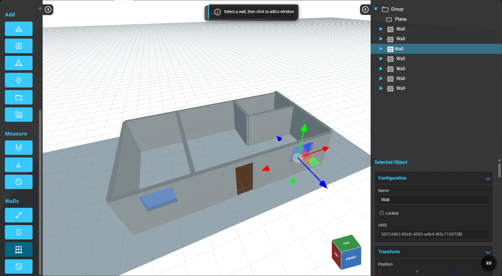

### Add and customize doors, windows, and gates

1. Select the target wall, then open **Model Library > Doors, windows and gates** and choose **Door**, **Window**, or **Gate**.
2. Double-click the desired position on the wall. A direct hit selects that wall, creates the opening as its child, and cuts the wall geometry around it. The tool remains active for additional openings; choose **Exit wall and floor tools** when finished.
3. Select the opening in the scene or object tree. Use **Move** to reposition it along the wall. Moved openings align with and attach to the nearest finite wall segment and remain within that wall's bounds.

All three opening types provide width, visible height, panel thickness, **Open**, and **Opening (%)** controls. Set the percentage to `0` for closed, `100` for fully open, or an intermediate value. **Open** is a shortcut for fully open or closed.

| Opening | Customization available in the inspector                                                                                                                                                                                                                                                                                  |
| ------- | ------------------------------------------------------------------------------------------------------------------------------------------------------------------------------------------------------------------------------------------------------------------------------------------------------------------------- |
| Door    | Hinged or sliding operation; single or double panels; hinge/slide side; inward/outward swing; no knob, round knob, lever, or bar handle; hardware color; optional trim; and an optional glazed opening with configurable size, position, trim, tint, and opacity.                                                         |
| Window  | Hinged or sliding operation; one or two hinged sashes; movable left/right sliding sash; inward/outward swing; frame/trim; glass tint, opacity, and roughness; pane grid rows, columns, bar width, and spacing; horizontal blinds; and louvered shutters. Sliding windows always use two framed sashes on separate tracks. |
| Gate    | Door-style swinging or sliding operation; single or double panels; hinge/slide side; inward/outward swing; a solid panel or vertical bars; and bar width/spacing. A gate always cuts the wall to its full height, even when the visible panel is shorter.                                                                 |

#### Control openings with Home Assistant entities

Use the entity selector beside an opening control to associate it with Home Assistant:

- **Openness entity ID** controls the main door, window, or gate panel.
- **Blind openness entity ID** controls window blinds.
- **Shutter openness entity ID** controls the window's shutter doors.
- **Blade openness entity ID** controls the angle of the louvered shutter blades independently.

The selectors include `binary_sensor`, `cover`, `input_boolean`, `input_number`, `number`, `sensor`, and `switch` entities. DT3D converts their data as follows:

| Home Assistant data                | DT3D opening value           |
| ---------------------------------- | ---------------------------- |
| Numeric state                      | Clamped to `0`–`100` percent |
| Cover `current_position` attribute | Clamped to `0`–`100` percent |
| `on`, `open`, or `true`            | `100%` open                  |
| `off`, `closed`, or `false`        | `0%` open                    |

Selecting an entity makes the corresponding manual percentage field read-only. When the entity supplies a supported value, that value drives the opening automatically. Clear the entity ID to restore manual control. Blind openness is the inverse of **Blind position (% down)**, so a `100%`-open entity raises the blind to `0%` down.

For blinds, choose an inside or outside mounting location, slat spacing, and color. Shutters cover the full window and frame; choose an inside or outside mounting location (outside by default), one or two doors, the door-opening percentage, blade count, independent blade-opening percentage, and color. The opening configuration and all entity associations are saved with the space.

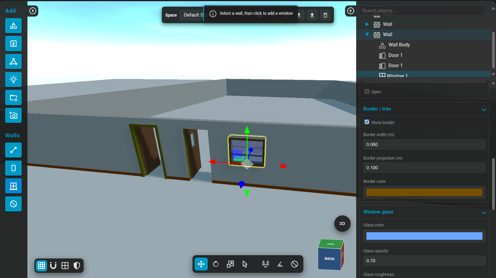

### Set up viewports

A viewport saves the current camera position, target, projection mode, field of view, and zoom.

1. Navigate to the desired camera position and choose **Create viewport**.
2. Rename the new viewport in the object inspector.
3. Move the camera, right-click the viewport in the tree, and use **Update viewport** whenever the saved camera should be replaced.
4. In the same menu, use **Set default viewport** to make it the default for the space. A space has at most one default viewport.
5. Optionally select a different `default_viewport` in a card's configuration. The card-specific choice overrides the space default for that card.

The optional orientation cube is separate from saved viewports. Double-click a cube face to align the camera to the front, back, left, right, top, or bottom.

### Organize objects with groups

- Create a group to organize objects into a hierarchy or tidy the object tree.
- Groups can be nested. Moving, rotating, scaling, or hiding a group affects all of its children, which is useful for rooms, floors, and entity-driven assemblies.

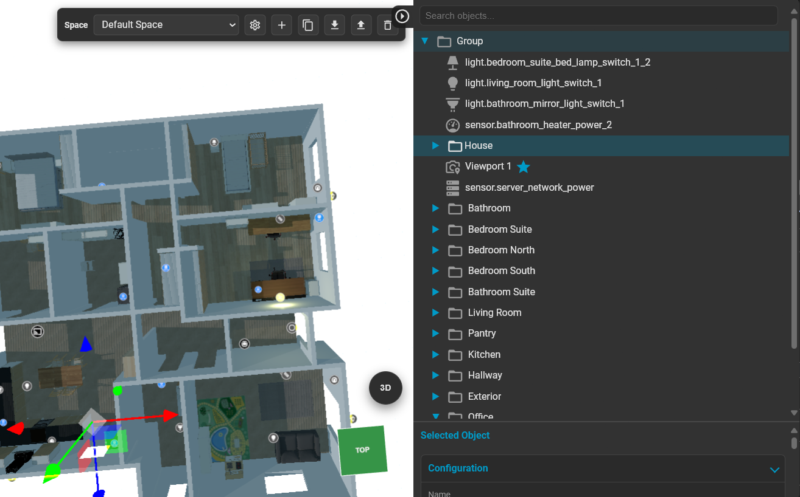

## Configure a space

Open **Space configuration** (cog icon) beside the space selector. The form contains the space name, description, default-space checkbox, appearance, daylight, tone mapping, and post-processing settings. These values are saved with the active space and affect every card that displays it.

### Appearance and daylight

- Enable the procedural sky for a daylight sky dome, or disable it and use a solid-color or transparent background. A transparent background allows the dashboard background to show through the card. The optional sun lens flare follows the same manual or Home Assistant-derived solar direction as the sky and is hidden whenever the sky is hidden.
- **Follow Home Assistant date and time** updates the sun position from Home Assistant's configured location and time. The manual elevation and azimuth remain the fallback when sun data is unavailable.
- Ambient color/intensity and sunlight color/intensity control the scene-wide base light and directional sunlight.

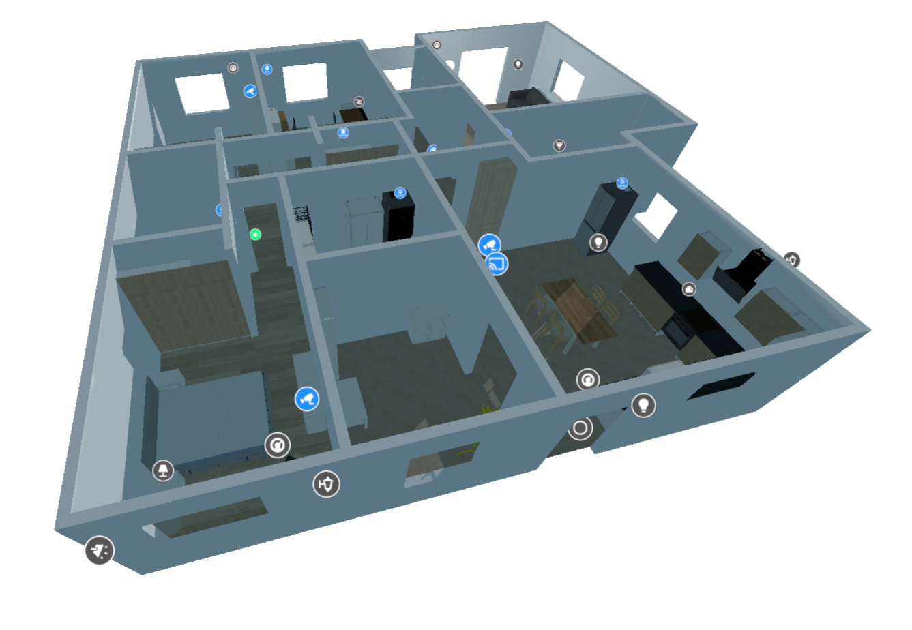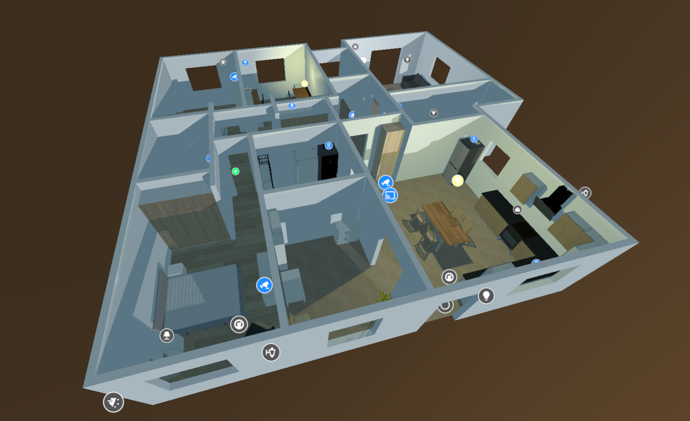

### Post-processing and appearance

| Section         | Options                                                                                                  |
| --------------- | -------------------------------------------------------------------------------------------------------- |
| Tone mapping    | None, Linear, Reinhard, Cineon, ACES Filmic                                                              |
| Post-processing | SSR, Bokeh depth of field, Bloom, GTAO, SSAO, Halftone, Film grain                                      |
| Appearance      | Procedural sky, sun lens flare, Home Assistant date/time following, and a solid-color or transparent fallback background |
| Daylight        | Ambient color/intensity, sunlight color/intensity, sun elevation/azimuth                                 |

SSR adds view-dependent reflections using information currently on screen, so reflected details can disappear at view edges. GTAO and SSAO are mutually exclusive. Post-processing can improve depth and style but is usually the largest GPU cost after high resolution and shadows. Grid visibility, grid size, and snap size are local editor aids rather than space appearance settings.

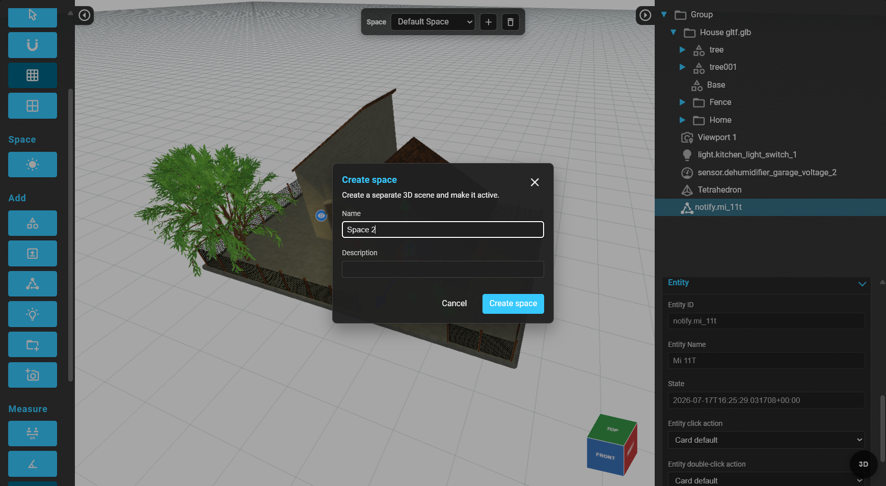

### Measurement tools

- The **Measure** section of the toolbar provides distance and angle measurements.
- Measurement points must be placed on a visible object surface.
- While taking a measurement, the hint box guides you through the required points.
- Completed distances and angles remain visible while you add more measurements or switch tools.
- Select **Clear measurements** to leave measurement mode and remove every completed or unfinished measurement.
- Measurements are editor helpers only and are not saved with the space.
- Selecting another tool, such as a wall tool, exits measurement mode without removing completed measurements.

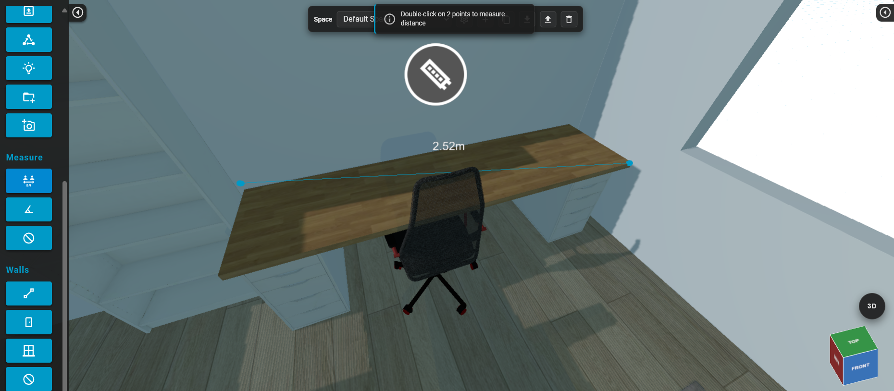

## Configure visualization cards

Create one or more normal dashboard cards with `visualization_only: true`. Editing controls and the object tree are hidden, while camera navigation and entity interactions remain available.

```yaml
type: custom:dt3d-card
address: https://home.example.com
port: 8080
service_key: replace-with-the-backend-service-key
default_space: 7b9b4c3d-choose-a-space-id
default_viewport: 6a8a2d10-optional-viewport-object-id
navigation_controls: orbit
orientation_cube: false
vr_mode: false
ar_mode: false
ar_location_based: false
ar_location_entity: ""
ar_environment_orientation: 0
visualization_only: true
hide_occluding_walls: true
entity_click_action: open
entity_double_click_action: open
general:
  rendering:
    antialiasing: false
    resolution: 0.75
    shadowMap:
      enabled: false
      type: pcf
      quality: medium
  lowPowerDeviceSettings:
    disableShadowMaps: true
    reduceShadowMapQuality: true
    disablePostProcessing: true
    disableAntialiasing: true
  developmentMode:
    enabled: false
```

Configure `default_space` in visualization mode because viewers cannot switch spaces there. Leave `default_viewport` empty to follow the space's default.

### Card configuration reference

| Option                                                  | Default            | Description                                                                                                                                       |
| ------------------------------------------------------- | ------------------ | ------------------------------------------------------------------------------------------------------------------------------------------------- |
| `address`                                               | `http://localhost` | Backend scheme and hostname, without the API path or trailing port.                                                                               |
| `port`                                                  | `8080`             | Exposed backend TCP port.                                                                                                                         |
| `service_key`                                           | empty              | Must exactly match the backend `service_key`.                                                                                                     |
| `default_space`                                         | first available    | Space ID opened by this card.                                                                                                                     |
| `default_viewport`                                      | space default      | Viewport object ID opened by this card.                                                                                                           |
| `navigation_controls`                                   | `orbit`            | Camera interaction style: `orbit`, `map`, or `fly`.                                                                                               |
| `orientation_cube`                                      | `false`            | Shows the camera orientation cube.                                                                                                                |
| `vr_mode`                                               | `false`            | Shows a VR button when immersive VR is available through WebXR.                                                                                   |
| `ar_mode`                                               | `false`            | Shows an AR button when immersive AR is available through WebXR.                                                                                  |
| `ar_location_based`                                     | `false`            | Centers AR on a Home Assistant location entity.                                                                                                   |
| `ar_location_entity`                                    | empty              | Entity ID with numeric `latitude` and `longitude` attributes.                                                                                     |
| `ar_environment_orientation`                            | `0`                | Front-of-environment bearing, clockwise in degrees from geographic north.                                                                         |
| `visualization_only`                                    | `false`            | Hides all editing and space-management controls.                                                                                                  |
| `hide_occluding_walls`                                  | `true`             | In visualization mode and at low camera angles, makes the nearest camera-facing wall, its attached openings and accessories, and at most one connected wall transparent. |
| `entity_click_action`                                   | `nothing`          | `open`, `toggle`, or `nothing`.                                                                                                                   |
| `entity_double_click_action`                            | `open`             | `open`, `toggle`, or `nothing`.                                                                                                                   |
| `general.rendering.antialiasing`                        | `false`            | Smooths geometry edges; changing it recreates the WebGL renderer.                                                                                 |
| `general.rendering.resolution`                          | `1`                | Internal scale: `1`, `0.75`, or `0.5`.                                                                                                            |
| `general.rendering.shadowMap.enabled`                   | `false`            | Enables shadows for compatible lights and meshes.                                                                                                 |
| `general.rendering.shadowMap.type`                      | `pcf`              | `basic`, `pcf`, `pcf_soft`, or `vsm`.                                                                                                             |
| `general.rendering.shadowMap.quality`                   | `medium`           | `very_high`, `high`, `medium`, or `low`; uses separate directional and point-light resolutions.                                                   |
| `general.lowPowerDeviceSettings.disableShadowMaps`      | `false`            | Disables shadow maps on phones and tablets.                                                                                                       |
| `general.lowPowerDeviceSettings.reduceShadowMapQuality` | `false`            | Uses the `low` shadow-map quality preset on phones and tablets.                                                                                   |
| `general.lowPowerDeviceSettings.disablePostProcessing`  | `false`            | Disables every configured post-processing effect on phones and tablets.                                                                           |
| `general.lowPowerDeviceSettings.disableAntialiasing`    | `false`            | Disables WebGL antialiasing on phones and tablets.                                                                                                |
| `general.developmentMode.enabled`                       | `true`             | Shows connection status and build timestamp. Disable for normal dashboards.                                                                       |

Shadow-map quality maps to directional/point-light sizes as follows: `very_high` = 8192/1024, `high` = 4096/512, `medium` = 2048/256, and `low` = 1024/128. The renderer automatically falls back to a supported power-of-two size when the GPU texture or cubemap limit is lower.

Connection, antialiasing, resolution, shadow maps, mobile low-power overrides, and development mode are per-card. Tone mapping, post-processing, and daylight are per-space. Low-power overrides are applied at runtime without changing the saved space configuration.

WebXR immersive modes require a supported browser/device and HTTPS. During an AR session, the sky is hidden and the scene background is forced transparent; the saved space appearance is restored when AR ends. Location-based AR also requires device geolocation and absolute-orientation permission. It converts the device-to-entity geographic offset to meters and aligns the space using the configured bearing.

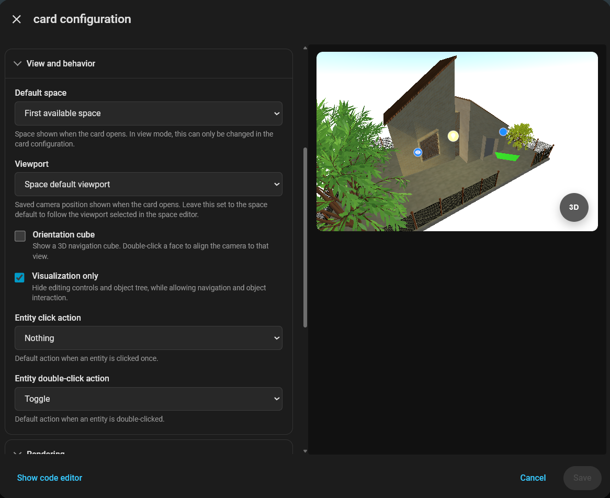

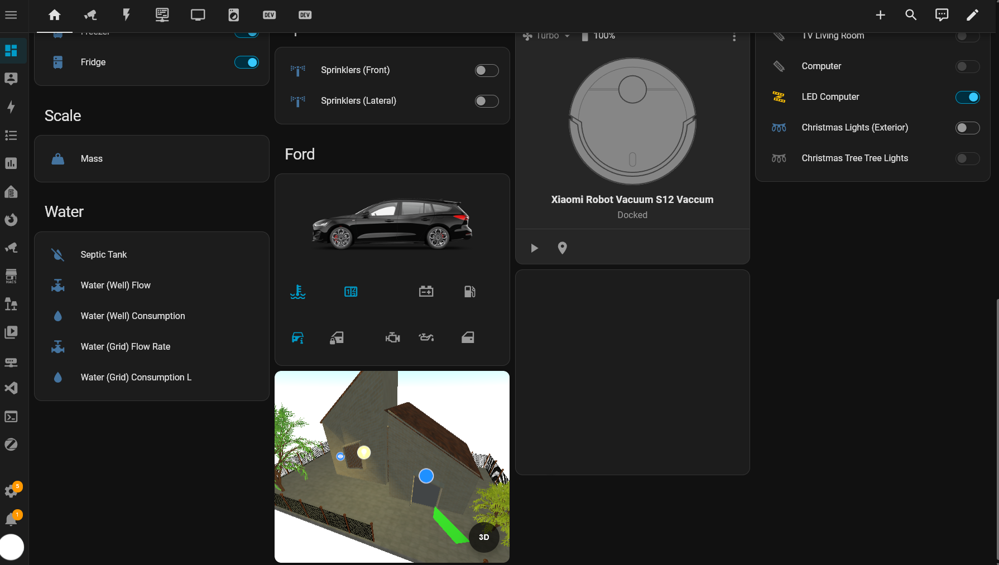

## Data synchronization

- A progress indicator appears below the space bar while DT3D loads data from or stores changes on the server. In compact layouts, progress becomes a thin line along the space bar; the object dock also explains its loading state.
- Wait for the indicator to clear before closing or reloading Home Assistant; unsynchronized changes can otherwise be lost.

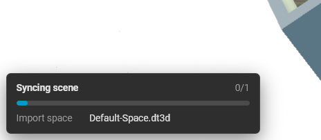

## Performance optimization

The 3D renderer is GPU-bound. Start with the following profile on phones, wall tablets, integrated GPUs, or other low-power devices:

```yaml
general:
  rendering:
    antialiasing: false
    resolution: 0.75
    shadowMap:
      enabled: false
      type: basic
      quality: low
  lowPowerDeviceSettings:
    disableShadowMaps: true
    reduceShadowMapQuality: true
    disablePostProcessing: true
    disableAntialiasing: true
  developmentMode:
    enabled: false
```

Then optimize in this order:

1. Lower `resolution` from `1` to `0.75`, then `0.5`. This usually gives the largest improvement with the smallest visual change.
2. Disable shadow maps. If shadows are required, use `basic` first, limit the number of shadow-casting lights, and disable **Cast shadows** on lights and meshes that do not need them. Select a mesh and expand **Shadows** in the object inspector: **Cast shadows** controls whether the mesh projects a shadow, while **Receive shadows** controls whether shadows are drawn on its surface.
3. Disable post-processing in **Space configuration**. SSR is demanding; lower its effect resolution scale before enabling it on constrained hardware. Avoid stacking several effects; GTAO and SSAO cannot be enabled together.
4. Keep antialiasing off on high-DPI displays. Test it only after resolution and shadows are acceptable.
5. Prefer optimized `.glb` models, fewer polygons/materials, compressed textures, and fewer camera entities. Camera objects load and refresh their still images only while their pointer-hover preview is visible.
6. Split very large homes into separate spaces or dashboard views so clients do not render everything at once.

## Troubleshooting

- **An object cannot be moved or reordered:** select it and disable its locked state in the inspector.
- **A wall point cannot be placed:** double-click a visible surface or an empty area over the ground grid plane. A camera ray parallel to the ground plane cannot produce a fallback point.
- **Colored lines appear while drawing walls:** these are temporary [smart snap guidelines](#draw-walls), not scene objects. Green means endpoint snap, blue means endpoint alignment, and red means parallel alignment.
- **A wall will not stay on a plan axis:** hold **Ctrl** while moving the preview and keep it held while double-clicking the endpoint.
- **A door or window is added to the wrong wall:** double-click directly on the intended wall, or move the opening near that wall so it reattaches to the nearest segment.
- **An opening does not follow its entity:** confirm that the entity has a numeric state, a numeric cover `current_position`, or one of the supported open/closed states. Clear and reselect the entity ID if it was renamed.
- **An entity rule does not react:** confirm the exact entity ID and primary state. State triggers compare text exactly apart from case; interpolation requires a numeric primary state and does not read entity attributes.
- **A measurement point is not added:** double-click a visible object surface. Clicking empty scene space does not create a measurement point.
- **Grid settings differ on another device:** grid configuration is stored locally in each browser and is not part of the space.
- **Imported model has missing materials/textures:** use a self-contained `.glb` or apply a texture through the object inspector.
- **The scene is slow on a phone or wall panel:** start with the profile in [Performance optimization](#performance-optimization), then reduce model and texture complexity.

For card loading, connection, authorization, mixed-content, certificate, or space-list problems, see [Setup troubleshooting](SETUP_GUIDE.md#setup-troubleshooting).
