# Digital Twin 3D user manual

[Studio walkthrough](#studio-walkthrough) · [Measurements](#measurement-tools) · [Space appearance](#configure-a-space) · [Post-processing](#post-processing) · [Visualization cards](#configure-visualization-cards) · [Troubleshooting](#troubleshooting)

## Studio walkthrough

Build a 6 m × 4 m room with a door, a window, furniture, and an oak floor. Connect a Home Assistant light, a door toggle, and a chair rotation helper, then place the Stanford Bunny on the table.

Open the DT3D editing card in Home Assistant. For installation and connection steps, see the [setup guide](SETUP_GUIDE.md#create-the-fullscreen-editor).

[Editor tour](#editor-tour) · [Create a space](#1-create-a-space) · [Draw the floorplan](#2-draw-the-floorplan) · [Add openings](#3-add-a-door-and-window) · [Furnish the room](#4-furnish-the-room) · [Connect entities](#5-import-and-connect-home-assistant-entities) · [Add a texture](#6-create-and-assign-a-textured-material) · [Import a model](#7-import-a-3d-model) · [Test the room](#8-test-the-finished-space)

### Editor tour

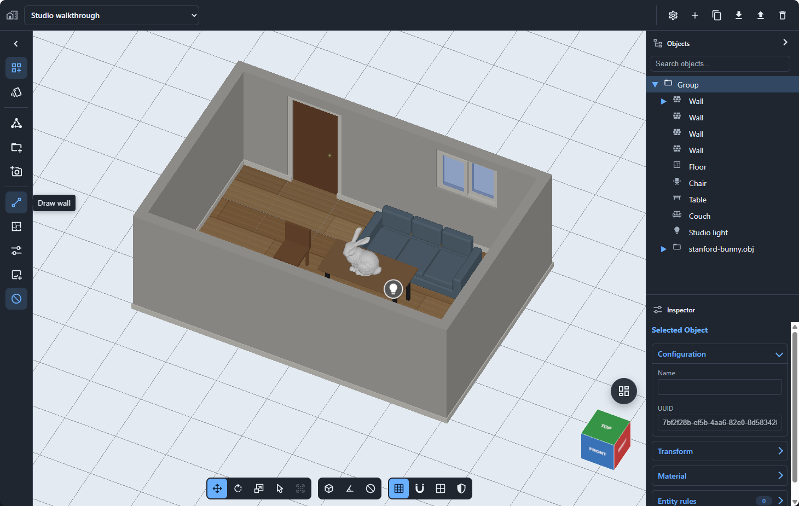

| Where | Controls |
| --- | --- |
| **Space bar** | Switch spaces, open **Space configuration**, or create, clone, download, upload, and delete spaces. |
| **Left rail** | Open **Model Library** or the material manager. Add an **Entity**, a group, or a viewport. Draw walls and floors or load a floorplan reference. |
| **Objects** and **Inspector** | Find and select objects, then edit their properties. Drag the divider to resize the panels. |
| **Bottom toolbar** | Translate, rotate, scale, or focus a selection. Measure distances and angles. Toggle the grid or snapping, configure the snap size, and prevent objects from clipping while you move them. |
| **Camera** | Switch between perspective and orthographic views with the round button. Double-click a face of the orientation cube to align the view. |

- Hover over or focus a button to see its label. Use the side chevrons to collapse either panel.
- With orbit controls, left-drag to orbit, right-drag to pan, and scroll to zoom.
- Click an object in **Objects** or double-click it on the canvas. Use **Ctrl/Cmd** to add to the selection or **Shift** to select a range in the tree. Right-click for **Move to point**, **Clone**, and **Delete**.
- Use **Ctrl/Cmd+Z** to undo and **Ctrl/Cmd+Shift+Z** to redo.

### 1. Create a space

1. Click **Create space** (plus) in the top bar.
2. Name the space **Studio walkthrough** and confirm with **Create space**.
3. If you see a starter **Cube** and **Plane** in **Objects**, right-click each, choose **Delete**, and confirm.

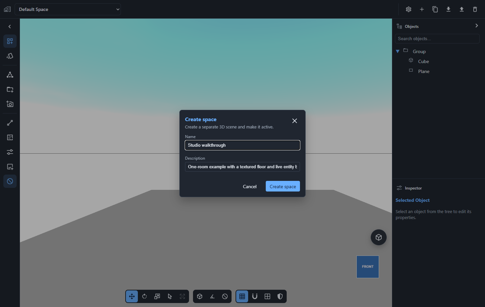

### 2. Draw the floorplan

#### Draw walls

1. Switch to orthographic projection and double-click **TOP** on the orientation cube. You can also orbit until you are looking down.
2. Turn on **Snap transforms to grid**. Set **Snap size** to `0.5` m in **Configure grid**. Under **Wall creation**, keep **Create floors automatically** enabled and use a wall height of `2.40` m. Enable **Default bottom decoration** if you want baseboards.
3. Click **Draw wall** and double-click the first corner on the grid. Move the pointer until the length label reads 6 m, then double-click the next corner. Hold **Ctrl** while placing a point to constrain the segment to the X or Z axis.
4. Add a 4 m side and another 6 m side, then double-click the starting corner to close the last 4 m side. **Floor** appears in **Objects** when the walls form a closed loop. Click **Exit wall and floor tools**.

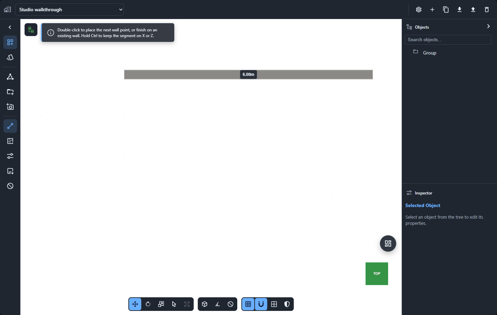

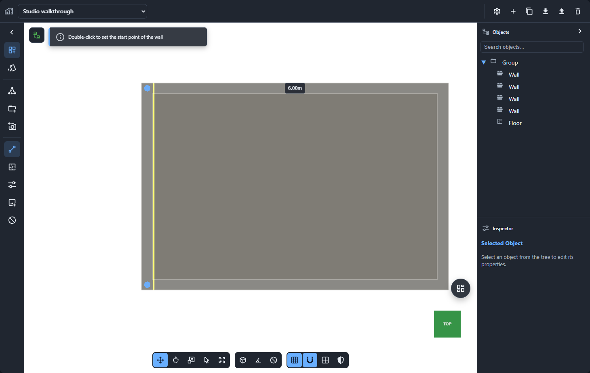

As you draw, a green guide snaps to an existing corner, blue aligns endpoints, and red aligns parallel walls. Double-click an existing wall to join it and end the run.

#### Add and calibrate a reference image

1. Click **Floorplan reference** and select an image of the plan.
2. Click two points with a known separation and enter that distance in meters.
3. Choose **Add floorplan**, then draw the walls over the scaled image.

#### Edit walls and floors

- **Reshape a wall.** Select it, double-click a blue endpoint handle, and drag it. Walls sharing that endpoint move together and the automatic floor follows the boundary. You can also edit coordinates or length under **Wall dimensions**.
- **Draw a floor manually.** Choose **Draw floor surface** and double-click at least three corners on a visible surface. Double-click near the first point to finish. The first point sets the height. Press **Escape** to cancel the outline.
- **Generate or merge floors.** Select the walls of a closed room without a floor and choose **Generate floor from selected walls** in the right-click menu. To merge, select unlocked floors on the same plane. Move child objects out of every floor except the first, then choose **Merge Floors**. The first floor supplies the name and material.

### 3. Add a door and window

1. In **Model Library**, open **Doors, windows and gates** and choose **Door**. Double-click the back wall to the left of center.
2. Repeat with **Window**, placing it to the right of center. Use the same steps for a gate. Click **Exit wall and floor tools** when finished.
3. Expand the wall in **Objects** and select the opening. Set its dimensions and **Opening (%)** in the inspector. Use the translate control to slide it along the wall.

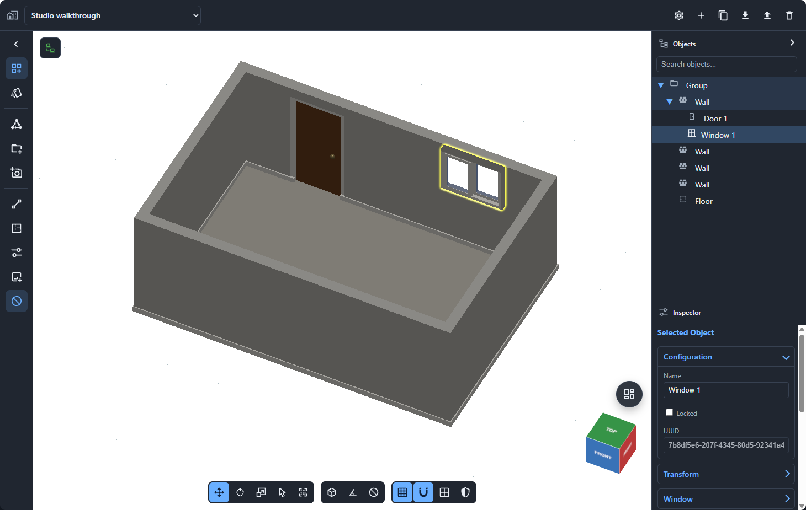

### 4. Furnish the room

1. Open **Model Library**. Browse with **Filter by room** or use the search box.
2. Select **Chair**, move the outline onto the floor, and double-click to place it. Press **Escape** to cancel placement.
3. Place a **Table** near the center and a **Couch** under the window. Leave room for the door to swing.
4. Select any piece in **Objects** to adjust its size, position, or model settings in the inspector.

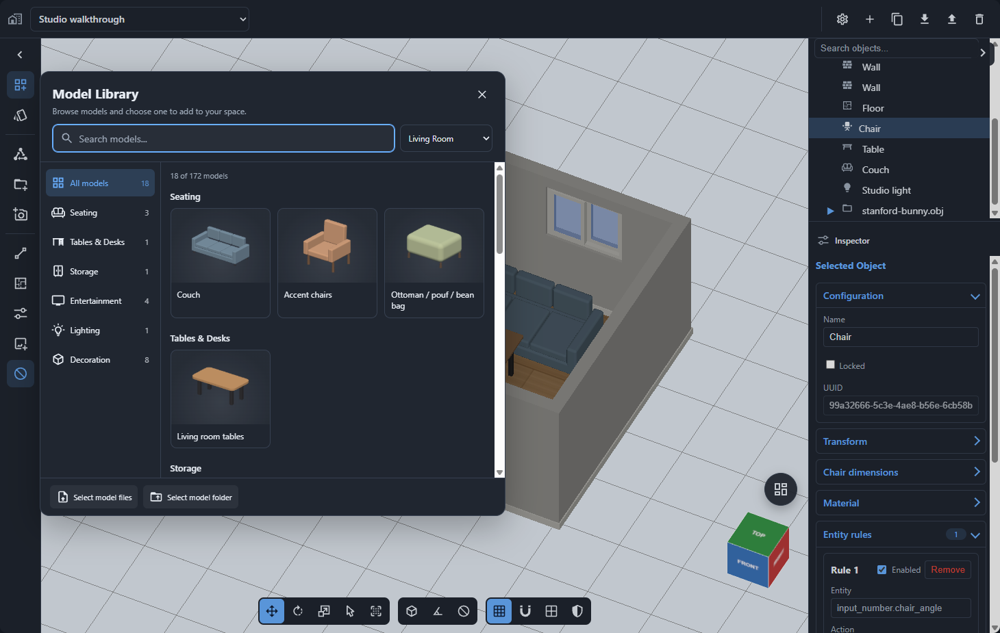

### 5. Import and connect Home Assistant entities

Use a Home Assistant light and create two helpers under **Settings → Devices & services → Helpers**. Add a **Toggle** named **Entry door** and a **Number** named **Chair angle**, with a range of `0` to `100` and a step of `1`. Use your actual entity IDs below. [Toggle helper](https://www.home-assistant.io/integrations/input_boolean/#configuration) · [Number helper](https://www.home-assistant.io/integrations/input_number/#creating-a-number-helper)

#### Import the light into the scene

1. Click **Entity** in the left rail, search for your light, and select it. The example uses `light.studio_light`.
2. Move the preview into the room and double-click to place it. Repeat for any sensors or switches you want to show in the scene.
3. In **Transform**, raise **Position Y** to `1.40` m. In **Lighting**, choose **Point Light** for **Source type**. The example uses **Intensity** `18` and **Range (m)** `6`.

DT3D follows the light's on/off state and uses its color when available. **Intensity** controls the brightness of the 3D light.

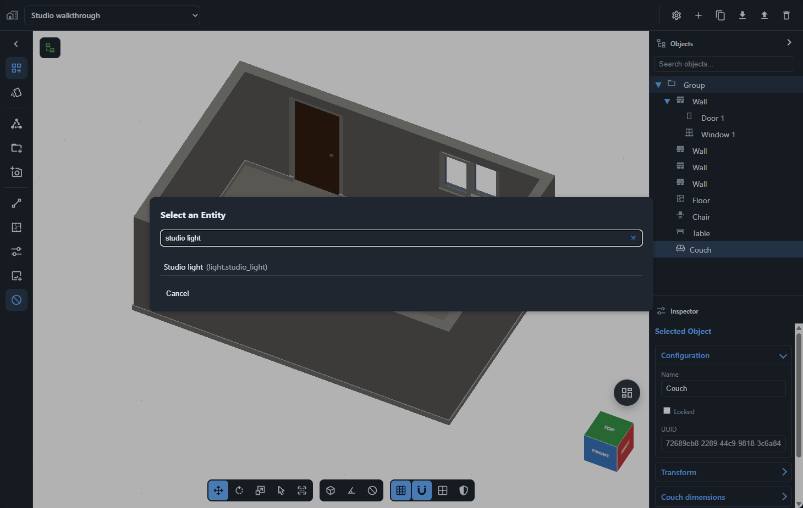

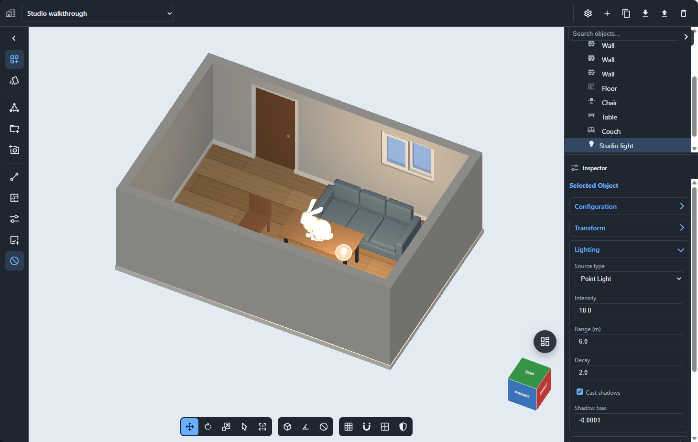

#### Bind the door to the toggle

1. Select the door in **Objects** and open **Door** in the inspector.
2. Set **Openness entity ID** to `input_boolean.entry_door`. The entity now supplies **Opening (%)**. Clear the entity ID to return to manual control.

A window or gate can use the same field. DT3D maps `on`, `open`, and `true` to 100%, and `off`, `closed`, and `false` to 0%. For partial openings, it accepts numeric states or a cover's `current_position` from 0 to 100. Windows also have separate entity fields for blinds, shutters, and louver blades.

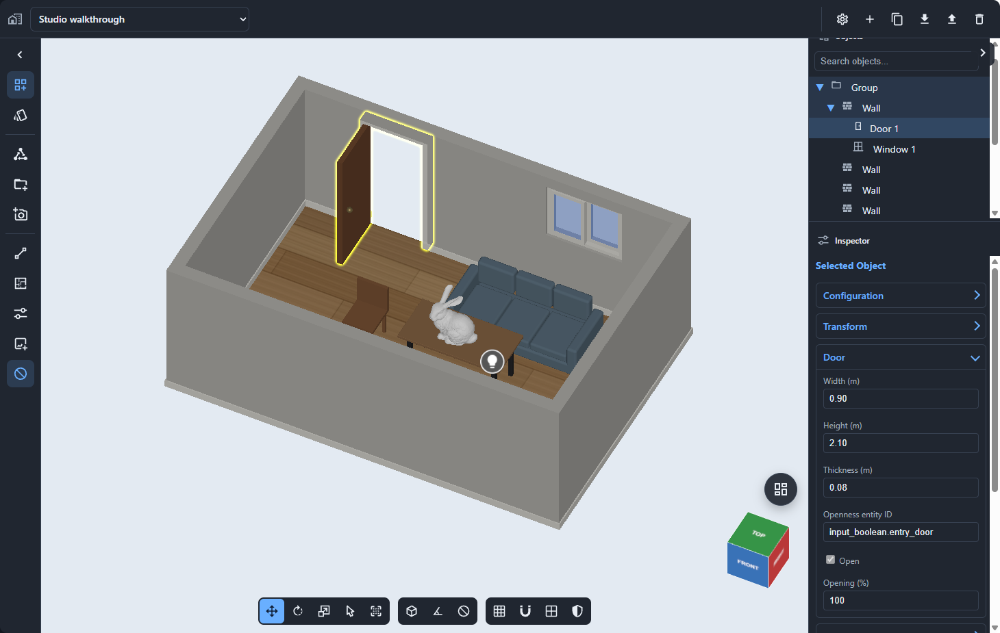

#### Rotate the chair from the number helper

1. Set the chair's resting rotation to `0°` and set the number helper to `0`.
2. Select **Chair**, expand **Entity rules**, and click **Add rule**.
3. Set **Entity** to `input_number.chair_angle`. Choose **Transform action**, **Rotation (degrees)**, and **Interpolate from entity value**.
4. Set **Entity value at original** to `0` and **Entity value at target** to `100`. Under **Configured transform**, set X and Z to `0` and Y to `90`. Keep the rule **Enabled**.

A rule can reference an entity ID directly. Other actions include **Color change** and **Hide**. A transform can also respond to a specific state. Interpolation uses the entity's main numeric state. If several matching rules change the same property, the last one takes priority.

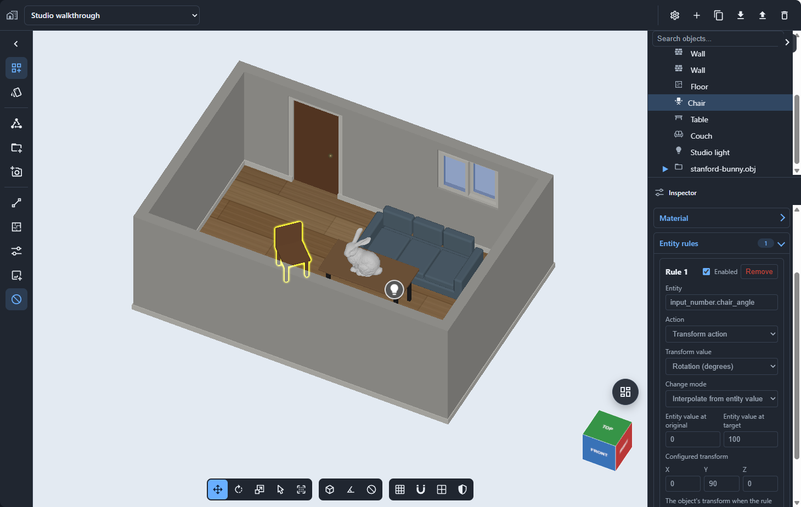

### 6. Create and assign a textured material

1. Click **Open material manager** (palette), then **New material** (plus).
2. Name it **Studio oak**. In **Base Color Map**, click the drop area and choose an image, or drop the image onto the field. [Download the example oak texture](readme/manual/studio-oak.png)
3. Keep **Mapping** at **UV** and both repeat values at `1`. To tile a texture, choose **Repeat** for **Wrap S** and **Wrap T** and increase **Repeat X** or **Repeat Y**.
4. Switch to a top view and drag the material tile onto a clear area of the floor. The material stays in the manager for reuse.

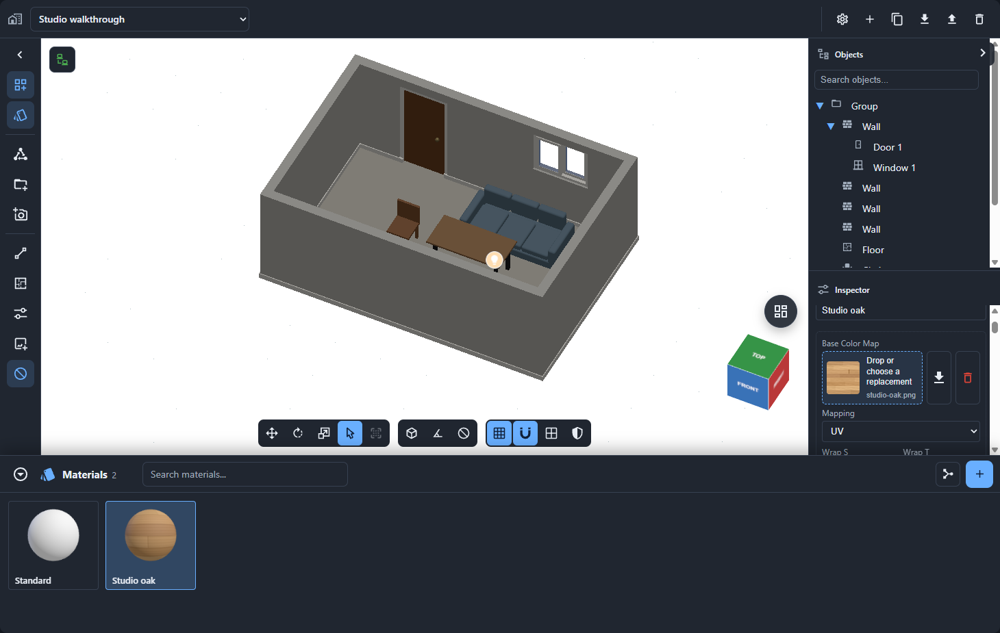

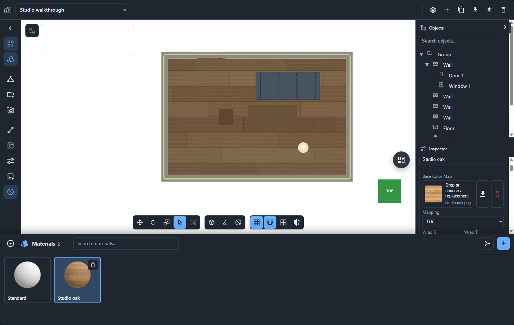

### 7. Import a 3D model

1. On GitHub, choose **Download raw file** and save `stanford-bunny.obj`. [Stanford Bunny OBJ](https://github.com/alecjacobson/common-3d-test-models/blob/master/data/stanford-bunny.obj)
2. In **Model Library**, choose **Select model files** and open the OBJ. Move the preview over the tabletop and double-click to place it.
3. Select the bunny in **Objects** and open **Transform**. Set the linked **Scale** to `4.5`. With the default table, set **Position Y** to about `0.60` m and check that the base rests on the tabletop.

DT3D accepts `.gltf`, `.glb`, `.obj`, `.fbx`, `.dae`, `.stl`, and `.3ds`. Include companion files when selecting a model or use **Select model folder** to retain relative paths. You can also drop model files onto the canvas.

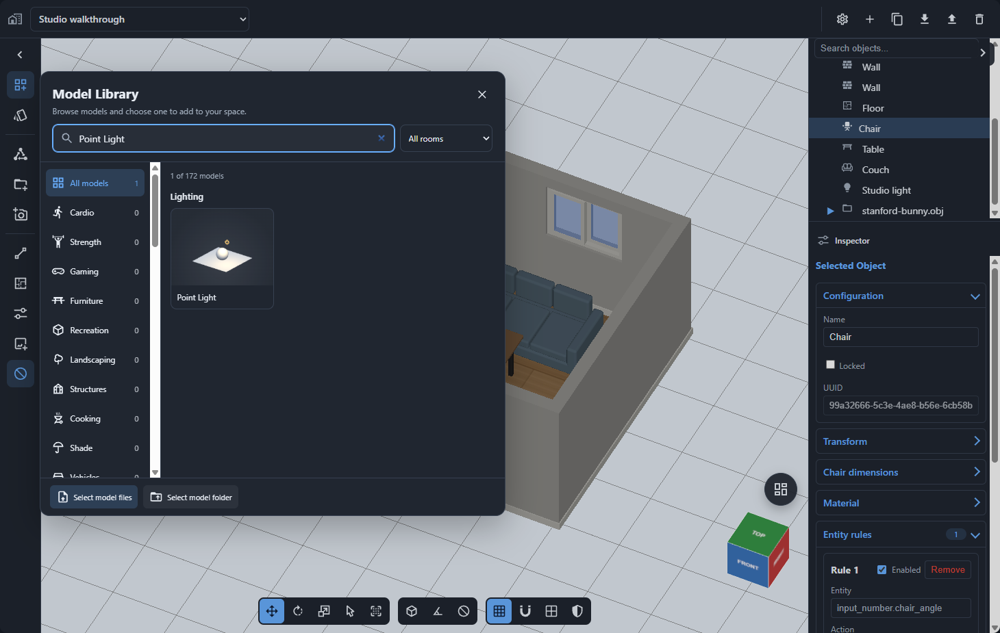

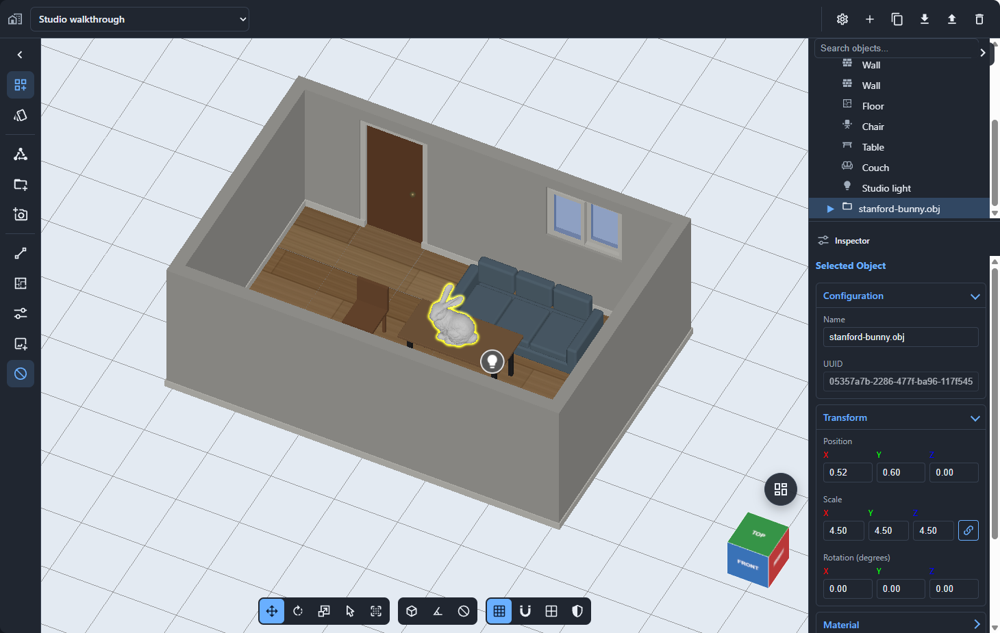

### 8. Test the finished space

Change the entities in Home Assistant with the DT3D card open. The screenshots use simulated values.

| Set the entities to | Look for |
| --- | --- |
| Light off, door toggle off, chair helper at `0` | Light off, door closed, chair in its resting pose. |
| Chair helper at `50` | Chair turned 45°. |
| Light on, door toggle on, chair helper at `100` | Light on, door open, chair turned 90°. |

| At rest | Active |
| --- | --- |
| 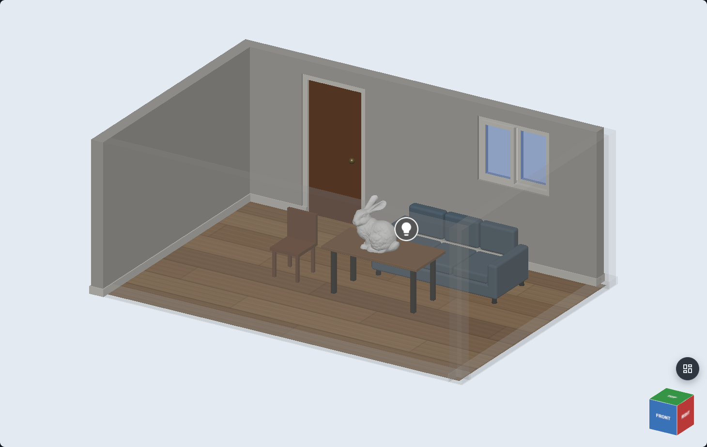 | 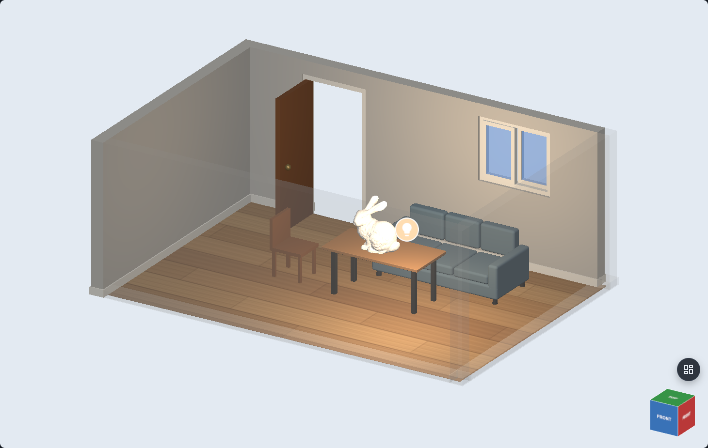 |

## Measurement tools

1. Orbit or switch to a top view so you can see the surfaces you want to measure.
2. Click **Measure distance** in the bottom toolbar, then double-click the start and end points. DT3D shows the straight-line distance in meters, including any height difference.
3. Click **Measure angle**. Double-click a point on the first side, the corner itself, and a point on the second side. DT3D shows the angle in degrees.
4. Keep measuring or switch tools to leave completed guides on screen. Click **Clear measurements** to exit measurement mode and remove all the guides.

Double-click a visible surface for each point. The floor or top of a wall works well in a plan view. Hover over a wall to see its length or a floor to see its area. Measurement guides are temporary.

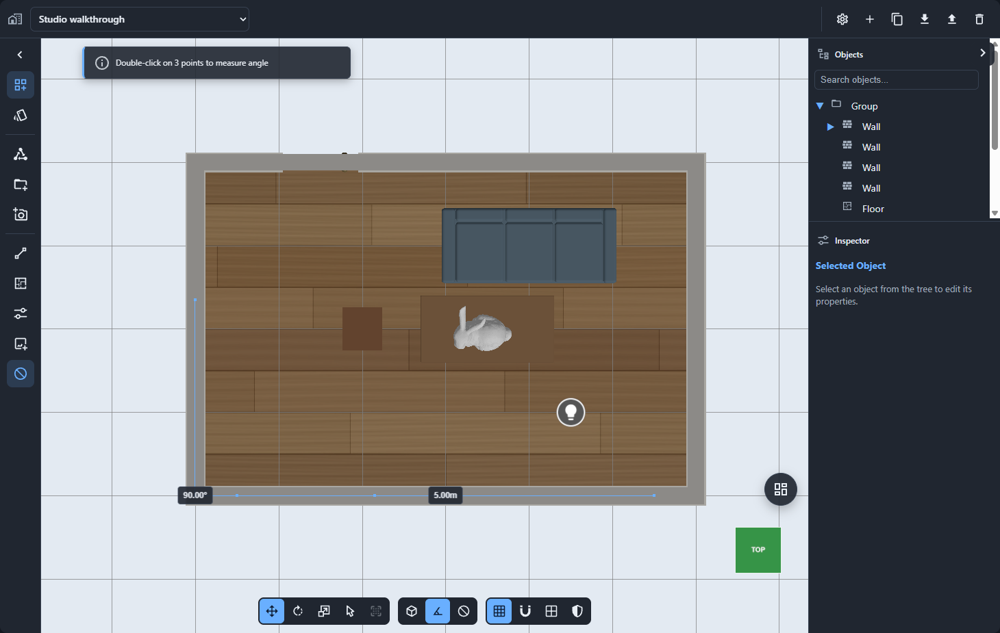

## Configure a space

Open **Space configuration** (gear) in the top bar. Changes save automatically and apply to cards showing the same space.

### Appearance and daylight

1. In **Appearance**, check **Sky enabled** to show the sky. Turn it off to use a **Solid color** or **Transparent** background.
2. In **Daylight conditions**, use **Ambient intensity** for the overall light level and **Sunlight intensity** for directional light. Set **Sun elevation** for height and **Sun azimuth** for direction.
3. To track the real sun, enable **Follow Home Assistant date and time** under **Appearance**. DT3D uses the Home Assistant location and time when available.

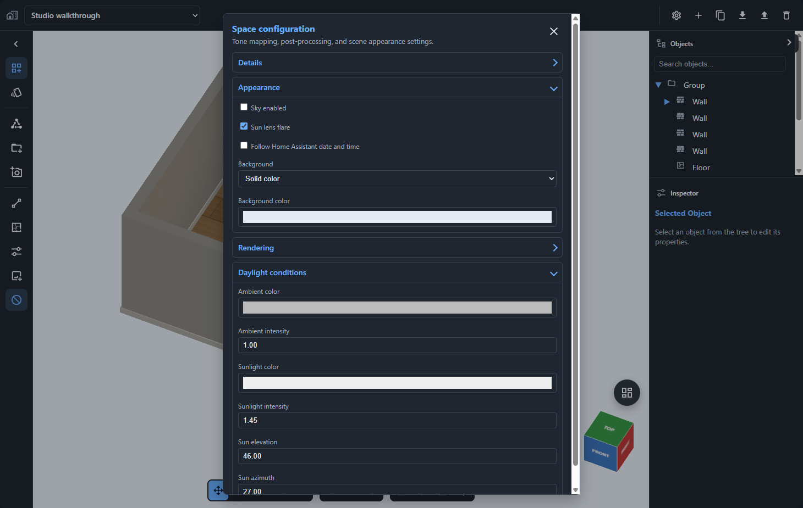

### Post-processing

1. Open **Space configuration → Rendering → Post-processing**.
2. Expand an effect and check **Enabled**. Start with one effect so you can see what it changes.
3. Adjust its settings and close the dialog to check the full scene. Reopen the effect and toggle **Enabled** to compare.

| Effect | What to adjust |
| --- | --- |
| **Screen-space reflections (SSR)** | Reflects objects visible to the camera. Reflections can fade near screen edges. Lower **Effect resolution scale** to trade detail for speed. |
| **Bokeh depth of field** | Blurs objects in front of or behind the focus plane. Set **Focus distance** to your subject, then adjust **Aperture** and **Maximum blur**. |
| **Bloom** | Adds a glow to bright areas. Lower **Threshold** to include more highlights. Use **Strength** and **Radius** to tune the glow. |
| **GTAO** or **SSAO** | Adds shading where surfaces meet. Adjust the radius to change how far the shading reaches. The editor enables one ambient occlusion effect at a time. |
| **Halftone** or **Film grain** | Adds a printed-dot pattern or animated grain. Adjust the pattern radius or grain intensity. |

To try Bloom in the studio, turn on the light and set **Strength** to `0.8`, **Radius** to `0.40`, and **Threshold** to `0.82`. Compare the glow around the tabletop with Bloom enabled and disabled.

**Tone mapping** sits above **Post-processing**. It controls how bright and dark tones are displayed. Phones and tablets skip the effects when the card's **Disable post-processing** low-power option is enabled.

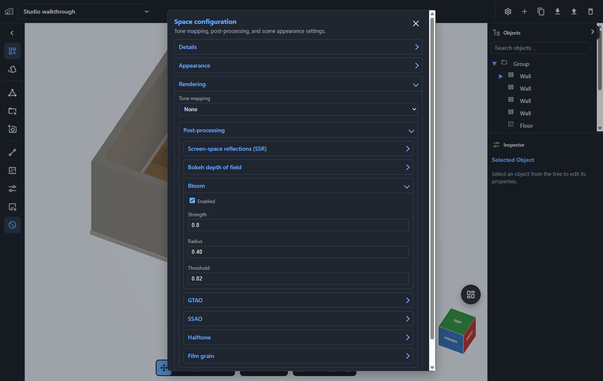

## Organize objects and camera views

### Organize objects with groups

1. Click **Create group** in the left rail. Select the new group in **Objects** and name it in the inspector.
2. Drag objects onto the group in **Objects**. Expand it to see its children.
3. Select the group to move, rotate, or scale its contents together. You can also nest groups.

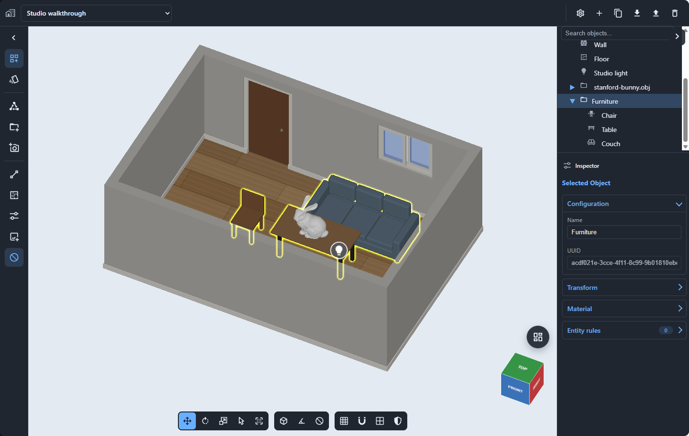

### Set up viewports

1. Position the camera and click **Create viewport** in the left rail.
2. Rename the viewport in the inspector. To replace its saved camera later, frame the scene and right-click the viewport to choose **Update viewport**.
3. In the same menu, choose **Set default viewport** to use it when opening the space. A card can override it with **Default viewport**.

## Manage spaces

| Task | What to do |
| --- | --- |
| Switch spaces | Choose a name from the **Space** list. |
| Rename or make a default | Open **Space configuration → Details**. |
| Duplicate a space | Click **Clone space**. |
| Back up or restore | Use **Download space (.dt3d)** or **Upload space (.dt3d)**. An archive contains the scene and its assets. Uploading opens a new copy. Entity bindings use the Home Assistant entities in the destination. |
| Delete a space | Click **Delete space** and confirm. This removes the space and its objects. |

### Data synchronization

DT3D saves edits to the backend while you work. Wait for the progress indicator to clear before closing or reloading the dashboard. If editing is blocked after a failed load, select **Retry loading space**.

## Configure visualization cards

1. Add a second DT3D card using the same backend settings as the editing card. [Editing card setup](SETUP_GUIDE.md#create-the-fullscreen-editor)
2. Enable **Visualization only** and choose the **Default space**. Choose a **Default viewport** if this card needs its own camera view.
3. Choose the click and double-click actions for entities. Use **Open** for Home Assistant's more-info dialog, **Toggle** for lights and switches, or **Nothing**.

For YAML, set `visualization_only: true` and use the space ID for `default_space`. The optional `default_viewport` takes a viewport object's ID. Leave it empty to use the space default. With `hide_occluding_walls: true`, nearby walls fade at shallow camera angles so the room is easier to see.

For immersive views, see the [VR and AR card settings](README.md#frontend-card).

### Performance optimization

1. In the card's **Rendering** settings, try resolution `0.75` or `0.5` and turn off antialiasing if needed.
2. Turn off shadows, or lower their quality and use fewer shadow-casting lights.
3. Turn off expensive effects under [Post-processing](#post-processing). On phones and tablets, you can disable all effects through the card's low-power settings.
4. Use smaller textures and models, and split very large layouts into separate spaces.

## Troubleshooting

| Problem | What to check |
| --- | --- |
| Closing a room leaves it without a floor | Check **Create floors automatically** in **Wall creation** and make sure the last wall joins the first corner. |
| A door or window lands on the wrong wall | Double-click the intended wall directly, or translate the opening near it so it reattaches. |
| An entity rule fails to respond | Check the entity ID and current state in Home Assistant. Check **Enabled** in the rule. Interpolation needs a numeric state. |
| A model is hard to find | Select it in **Objects**, click **Focus selected objects**, then check its scale and height. |
| A model is missing its textures | Import its companion files together or use a self-contained GLB. |
| An object cannot be moved | Select it and clear **Locked** under **Configuration**. |
| Grid settings differ across devices | Snap size and grid size are saved in each browser. |

For connection or installation issues, see [Setup troubleshooting](SETUP_GUIDE.md#setup-troubleshooting).
