# Digital Twin 3D user manual

Build **Studio walkthrough**, a 6 m × 4 m room with a door, a window, furniture, and an oak-textured floor. A Home Assistant light illuminates the room, a toggle opens the door, and a number helper rotates the chair. The Stanford Bunny OBJ sits on the table.

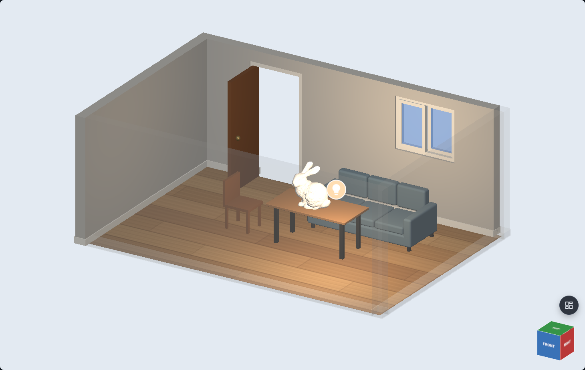

[Editor tour](#editor-tour) · [Create a space](#1-create-a-space) · [Draw the floorplan](#2-draw-the-floorplan) · [Add openings](#3-add-a-door-and-window) · [Furnish the room](#4-furnish-the-room) · [Connect entities](#5-import-and-connect-home-assistant-entities) · [Create a textured material](#6-create-and-assign-a-textured-material) · [Import the bunny](#7-import-a-3d-model) · [Test and save](#8-test-the-finished-space)

Open the DT3D editing card on your Home Assistant dashboard. A **Panel (one card)** dashboard view gives the editor the most room. If you still need to install or connect DT3D, start with the [setup guide](SETUP_GUIDE.md#create-the-fullscreen-editor).

The screenshots use the desktop editor connected to a local DT3D backend. The example Home Assistant states are simulated. Use the equivalent entities from your own dashboard when following along.

## Editor tour

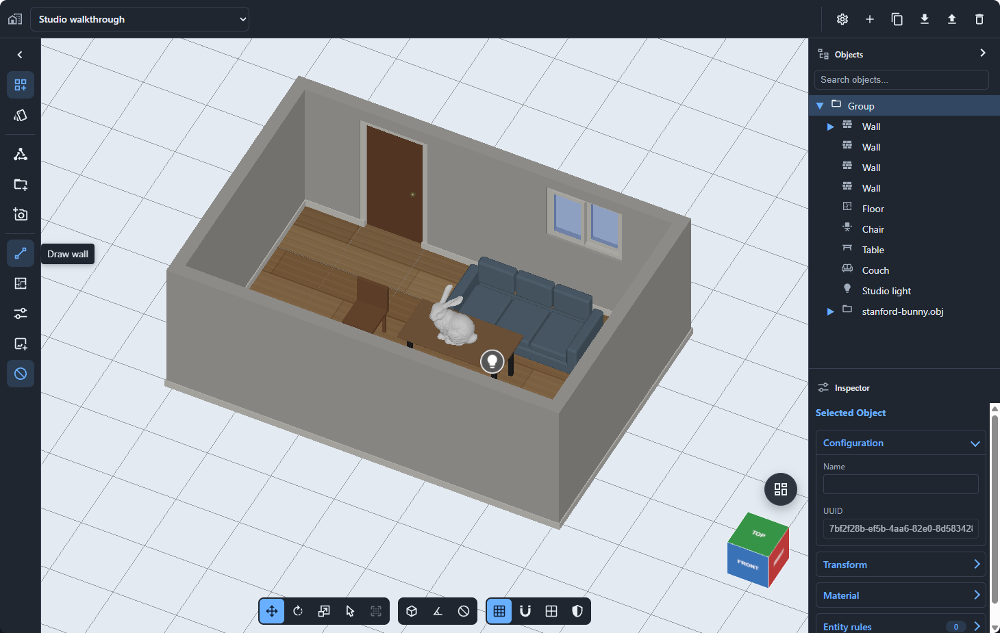

Hover over a button or focus it with the keyboard to see its name. The chevrons beside the left rail and right dock collapse or expand those panels.

| Where | What you can do |
| --- | --- |
| **Space bar** across the top | Switch scenes in **Space**. The buttons open **Space configuration**, create or clone a space, download or upload a `.dt3d` archive, and delete the active space. |
| **Left rail** | Open **Model Library** or **Open material manager**. **Scene tools** contains **Entity**, **Create group**, and **Create viewport**. **Floorplan** contains **Draw wall**, **Draw floor surface**, **Wall creation**, **Floorplan reference**, and **Exit wall and floor tools**. |
| **Objects** and **Inspector** on the right | Search or select objects in the tree. Expand a wall to see its door or window. Use **Inspector** to edit the selected object's dimensions, transform, and other properties. Drag the divider up when you need more room for the inspector. |
| **Bottom toolbar** | **Translate object**, **Rotate object**, **Scale object**, **Disable transform controls**, and **Focus selected objects**. **Measure distance** and **Measure angle** use points on visible surfaces. **Clear measurements** removes the measurement guides. **Toggle grid**, **Snap transforms to grid**, **Configure grid**, and **Prevent object clipping while moving** control placement. |
| **Camera** at lower right | Switch between perspective and orthographic projection with the round camera button. Double-click a face of the orientation cube to align the view, if the cube is enabled. |

With the default orbit controls, drag with the left mouse button to orbit, drag with the right button to pan, and scroll to zoom. Double-click an object on the canvas or click its name in **Objects** to select it. Right-click an object for actions such as **Move to point**, **Clone**, and **Delete**. Use **Ctrl/Cmd+Z** to undo and **Ctrl/Cmd+Shift+Z** to redo.

## 1. Create a space

1. Click **Create space** (the plus button in the top bar).
2. Enter **Studio walkthrough** as the name. Add a description if you like, then confirm with **Create space**.
3. If the new space shows a starter **Cube** and **Plane**, right-click each in **Objects**, choose **Delete**, and confirm. Start drawing on the empty grid.

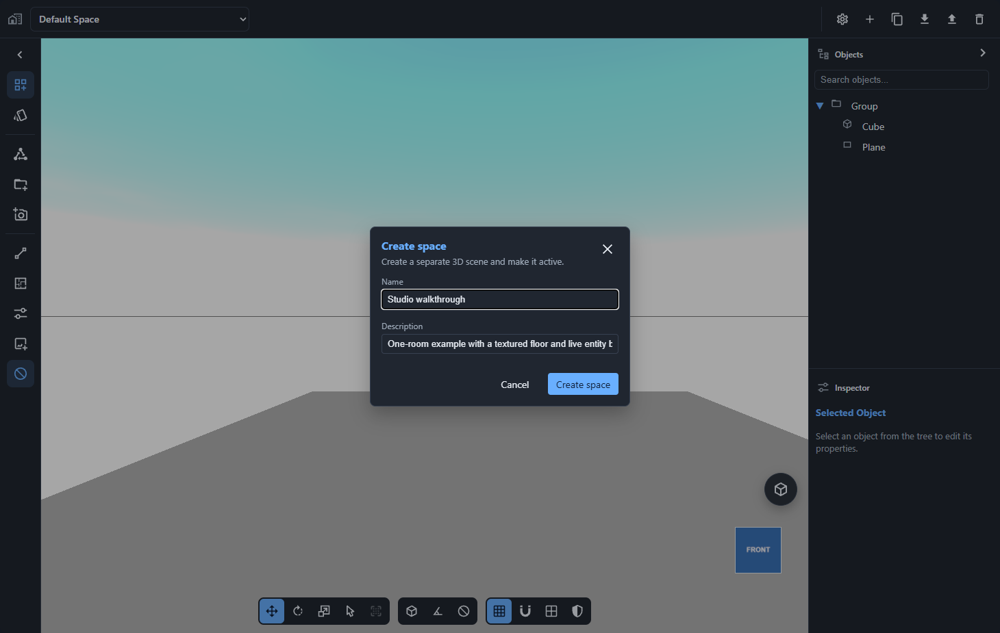

The new space opens automatically. DT3D synchronizes changes to the backend while you work. The gear in the top bar opens **Space configuration**, where you can change the name, default space, background, daylight, and rendering settings.

## 2. Draw the floorplan

1. Switch to orthographic projection and double-click **TOP** on the orientation cube. You can also orbit to a view looking straight down.
2. Turn on **Snap transforms to grid** (the magnet). In **Configure grid**, set **Snap size** to `0.5` m for this example.
3. Open **Wall creation** in the left rail. Leave **Create floors automatically** checked and keep the default wall height of `2.40` m. The example also uses **Default bottom decoration** to add baseboards.
4. Click **Draw wall**. Double-click the first corner. Move the pointer along the grid and use the length label to find a point 6 m away. Double-click to place the first wall. Hold **Ctrl** while positioning and placing a point to keep the segment on the nearest horizontal plan axis.
5. Double-click the next points to add a 4 m side, a 6 m side, and the last 4 m side. Place the last point on the first corner to close the loop. DT3D adds **Floor** to **Objects** when the wall centerlines enclose the room. Click **Exit wall and floor tools**.

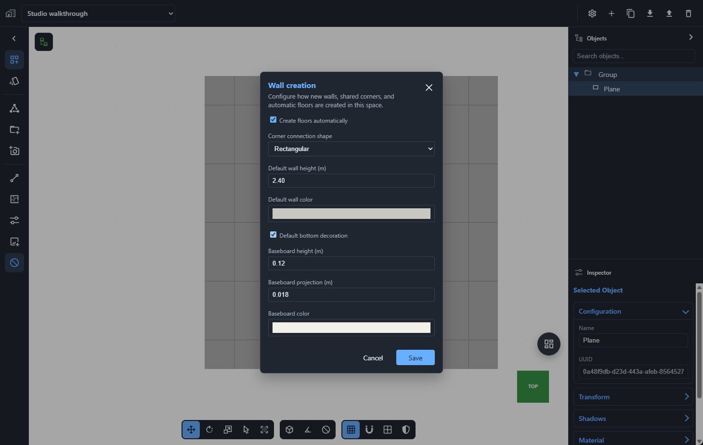

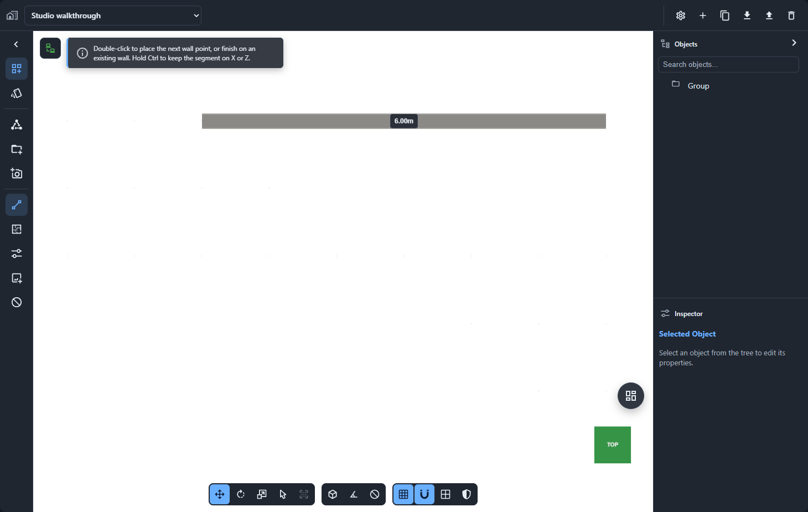

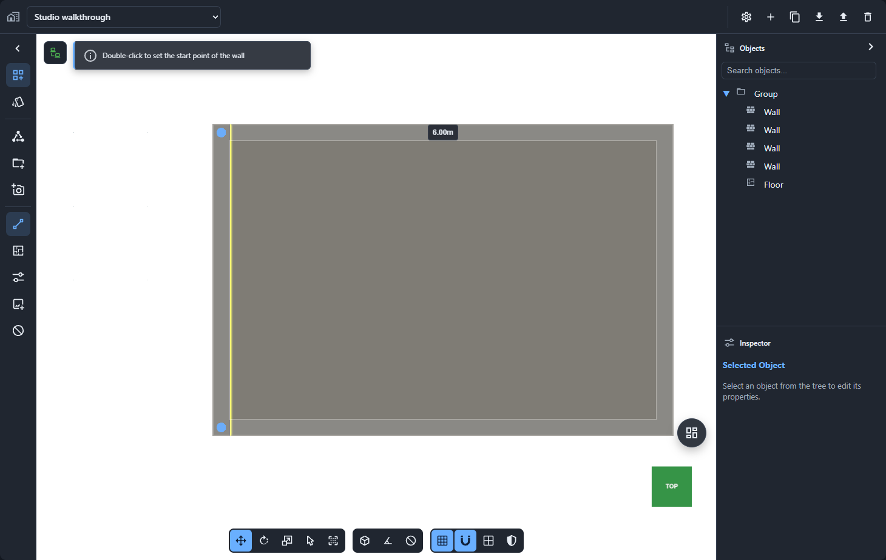

**Trace an existing plan.** Choose **Floorplan reference** and load an image of the plan. In the calibration dialog, click two points with a known separation, enter the distance in meters, and select **Add floorplan**. Draw the walls over the scaled image.

**Draw a separate floor.** Use **Draw floor surface** on a visible reference plane or other scene surface. Double-click every corner, then double-click near the first point to close the outline. The first point sets the height of the whole floor. Press **Escape** to cancel an unfinished outline. You can also select the walls of a closed room, right-click, and choose **Generate floor from selected walls** if the room has no floor.

## 3. Add a door and window

1. Open **Model Library** in the left rail. Under **Model categories**, select **Doors, windows and gates**, then choose **Door**.
2. Double-click the back wall where you want the door. The example puts it to the left of center. DT3D cuts the opening and adds the door under its wall in **Objects**.
3. Open the same category again, choose **Window**, and double-click the back wall to the right of center. Click **Exit wall and floor tools** when finished.
4. Expand that wall in **Objects** to select **Door 1** or **Window 1**. Adjust the width and height under **Door** or **Window** in the inspector. Orbit to an angled view to check that the openings sit where you expect.

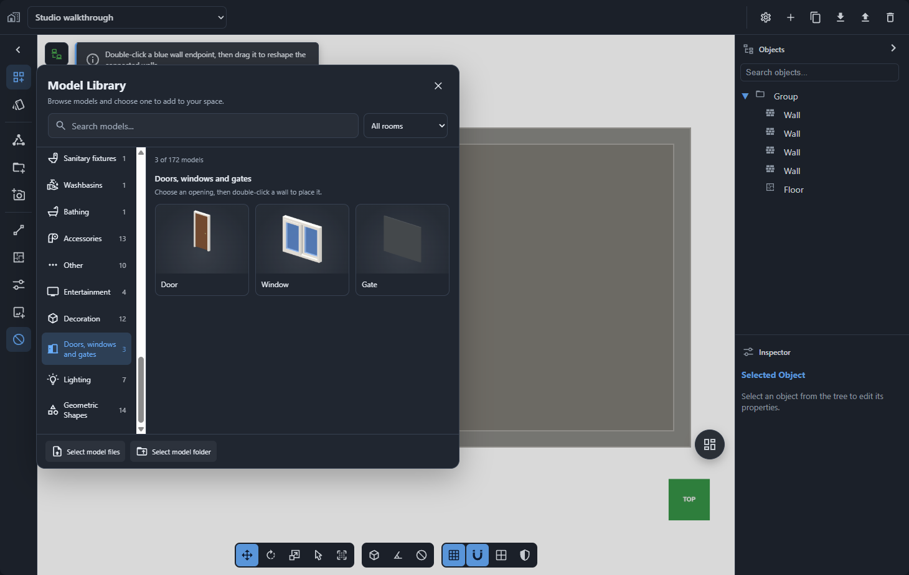

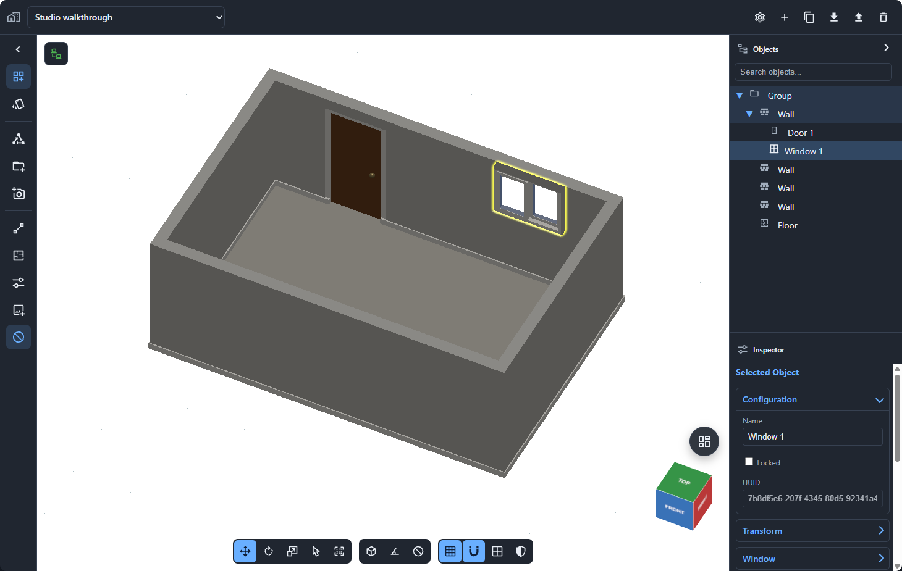

## 4. Furnish the room

1. Open **Model Library**. Use **Filter by room** to browse a collection such as **Living Room**, or set it to **All rooms** and search by name.
2. Search for **Chair** and select the tile named **Chair**. Move the outlined preview over the floor and double-click to place it. Right-click or press **Escape** to cancel a preview.
3. Repeat for **Table** and **Couch**. Place the chair on the left, the table near the center, and the couch along the wall under the window. Leave the door swing clear. In the example the chair starts at `0°` Y rotation.
4. Select an item in **Objects** to adjust its **Transform**. Open its furniture-specific section, such as **Chair dimensions**, to change its physical dimensions.

The library also includes **Geometric Shapes** and **Lighting**, with ambient, directional, point, spot, and rectangular area lights. For the next step, add the Home Assistant light from **Entity** in the left rail.

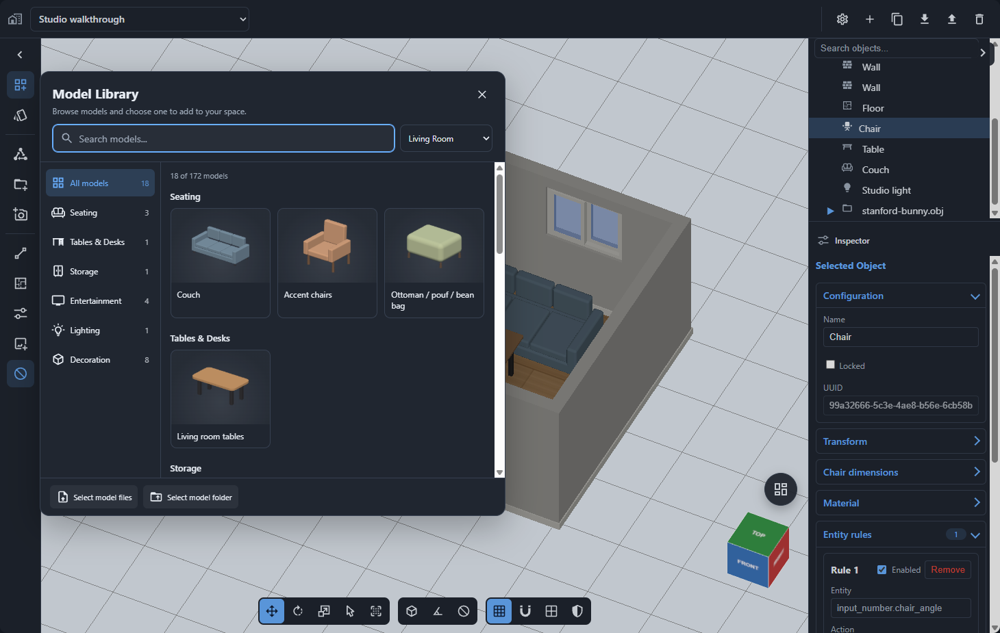

## 5. Import and connect Home Assistant entities

Use a light you can toggle and two helpers. In Home Assistant, open **Settings → Devices & services → Helpers** and choose **Create helper**. Create a **Toggle** named **Entry door** and a **Number** named **Chair angle** with a minimum of `0`, a maximum of `100`, and a step of `1`. Use the actual entity IDs assigned by Home Assistant. [Toggle helper](https://www.home-assistant.io/integrations/input_boolean/#configuration) · [Number helper](https://www.home-assistant.io/integrations/input_number/#creating-a-number-helper)

| Example entity | What it drives |
| --- | --- |
| `light.studio_light` | Turns the imported 3D light on or off and supplies its color. |
| `input_boolean.entry_door` | Opens the door at `on` and closes it at `off`. |
| `input_number.chair_angle` | Rotates the chair from its original angle to 90° as the value goes from 0 to 100. |

### Import the light into the scene

1. Click **Entity** in the left rail. Search by friendly name or entity ID and select your light from the results.
2. Move the preview into the room and double-click to place it. Repeat the same picker steps for any additional entity markers you want to display, such as a sensor or switch.
3. Select the light in **Objects**. In **Transform**, set **Position Y** to `1.40` m to raise it above the floor. In **Lighting**, choose **Point Light** for **Source type**. The example uses **Intensity** `18` and **Range (m)** `6`.
4. Toggle the light in Home Assistant to see the scene illumination switch on and off. DT3D uses the entity's supplied RGB or hue/saturation color when available. Set the 3D light's intensity in the inspector.

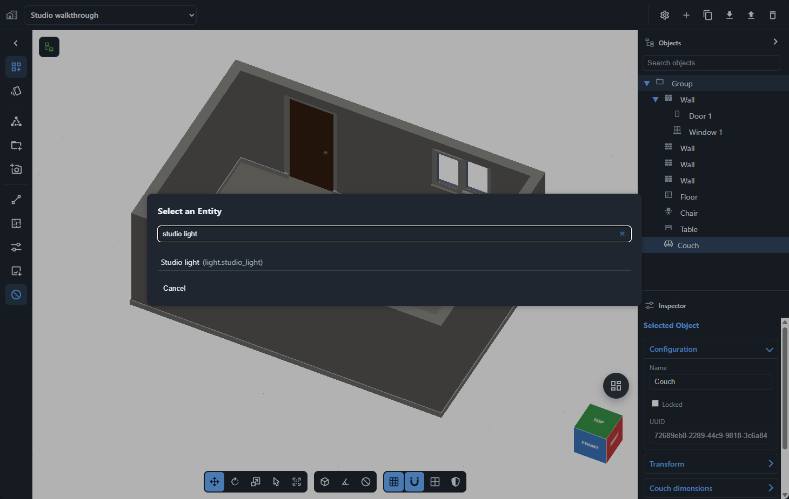

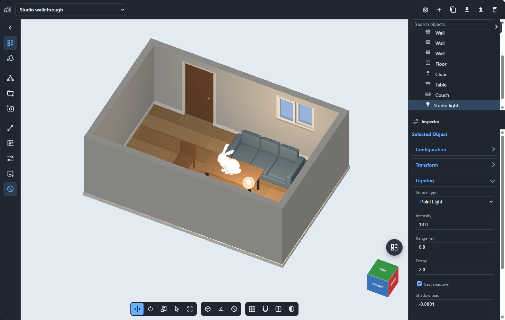

### Bind the door to the toggle

1. Select **Door 1** under its wall in **Objects**, then expand **Door** in the inspector.
2. Enter or select `input_boolean.entry_door` in **Openness entity ID**. The bound entity now supplies **Opening (%)**.
3. Toggle the helper **on** to open the door to `100%`. Toggle it **off** to close it to `0%`.

A door contact sensor can use its `on` or `off` state. A compatible cover can supply `current_position`, and a numeric state from `0` to `100` can represent partial opening. Use the actual states of your entity to verify the direction. The same **Openness entity ID** control is available for windows and gates.

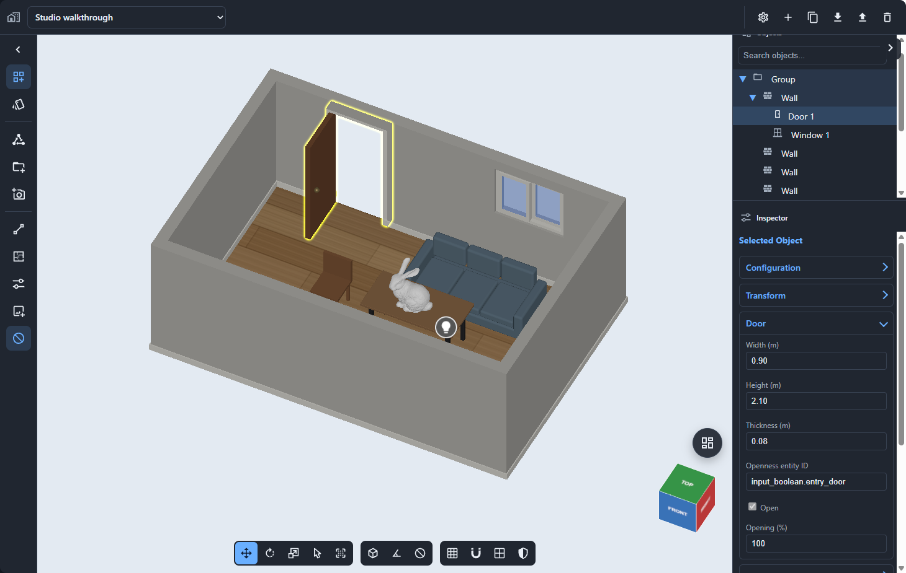

### Rotate the chair from the number helper

1. Set the chair to its resting pose and set the Home Assistant helper to `0`.
2. Select **Chair**, expand **Entity rules** at the bottom of the inspector, and choose **Add rule**.
3. Set **Entity** to `input_number.chair_angle`. Choose **Transform action** for **Action**, **Rotation (degrees)** for **Transform value**, and **Interpolate from entity value** for **Change mode**.
4. Set **Entity value at original** to `0` and **Entity value at target** to `100`. Under **Configured transform**, set **X** to `0`, **Y** to `90`, and **Z** to `0`. Keep the rule **Enabled**.
5. Set the helper to `50` in Home Assistant. The chair should turn to 45°. At `100` it should turn to 90°. At `0` it should return to its starting pose.

DT3D uses the chair's rotation when the rule is created as the original value. Y is the vertical axis, so the chair turns in place. For other furniture, **Entity rules** also offers position, scale, color change, and visibility actions. A rule can reference any available entity ID directly.

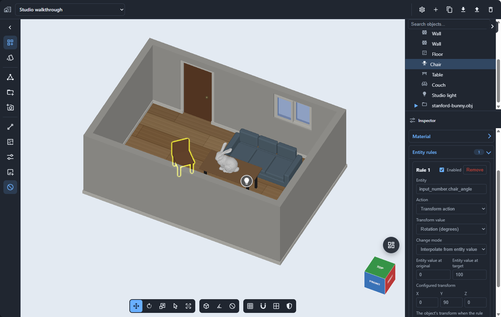

## 6. Create and assign a textured material

1. Click **Open material manager** (the palette icon in the left rail), then click **New material** (plus) in the material panel.
2. In the inspector, change **Material Name** to **Studio oak**. Click the drop area under **Base Color Map** and choose a PNG or JPG. You can also drop the image onto the field. [Download the example oak texture](readme/manual/studio-oak.png)
3. Leave **Mapping** at **UV**, with **Repeat X** and **Repeat Y** set to `1`, to use the whole image across this floor. To tile a seamless texture more densely, use **Repeat** for **Wrap S** and **Wrap T** and increase the repeat values. Optional maps such as **Normal Map** and **Roughness Map** have their own fields.
4. With the material panel open, switch to a top view so the floor is easy to hit. Drag the **Studio oak** material tile from the panel and drop it onto a clear area of the floor in the canvas. The floor updates and the tile shows that the material is in use.

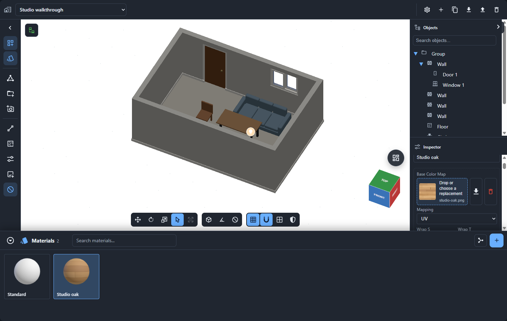

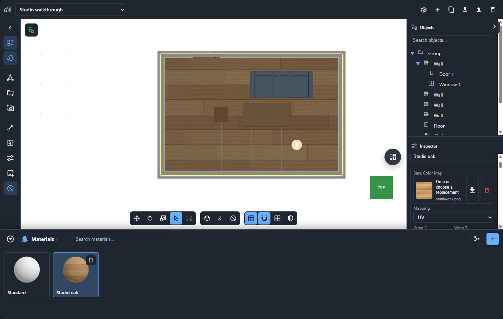

## 7. Import a 3D model

1. Open the model's GitHub page, click **Download raw file**, and save it as `stanford-bunny.obj`. The example uses the OBJ on its own. [Stanford Bunny OBJ on GitHub](https://github.com/alecjacobson/common-3d-test-models/blob/master/data/stanford-bunny.obj)
2. Open **Model Library** and click **Select model files** at the bottom. Choose the downloaded OBJ.
3. When the placement preview appears, move it over the table and double-click to place it. A top view makes it easier to aim at the tabletop. You can also drag a model file onto the canvas to import it at the drop point.
4. Select **stanford-bunny.obj** in **Objects** and expand **Transform**. The supplied model is small. Set its linked **Scale** to `4.5` on all three axes, then adjust **Position Y** until the base rests on the tabletop. The sample uses a Y position of `0.60` m with the default table.

DT3D accepts `.gltf`, `.glb`, `.obj`, `.fbx`, `.dae`, `.stl`, and `.3ds`. If a model uses companion material, texture, or buffer files, select them together or use **Select model folder** to keep their relative paths.

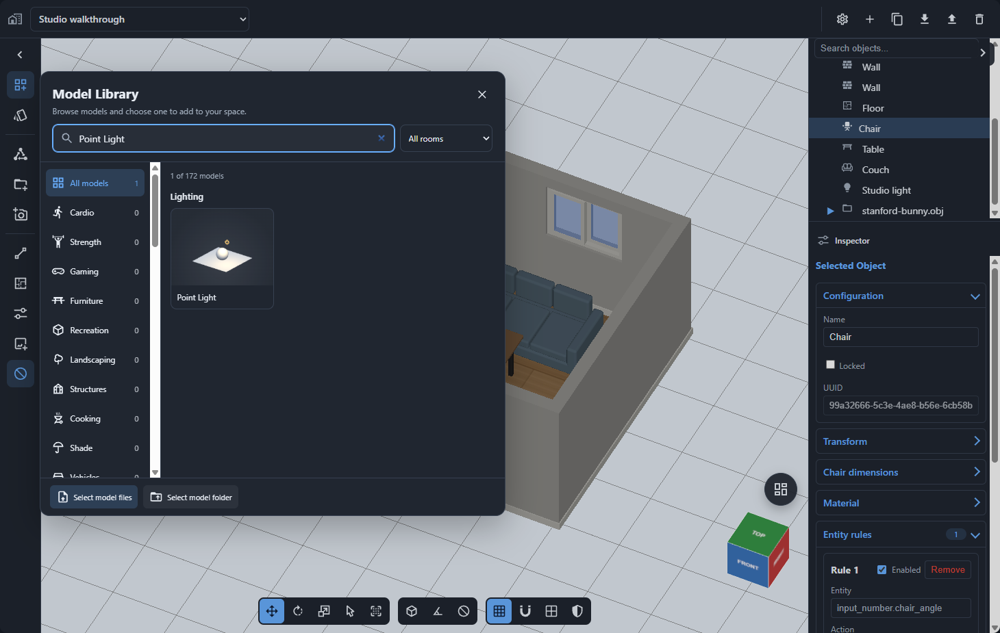

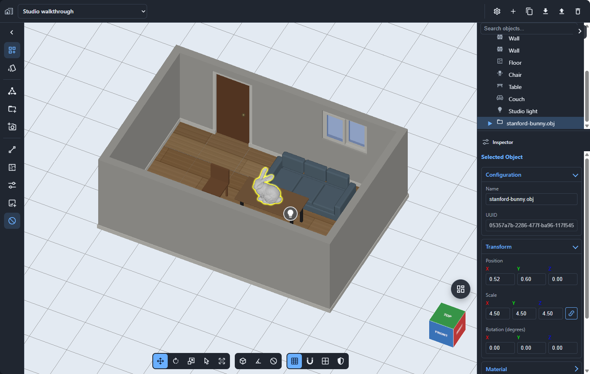

## 8. Test the finished space

Use your Home Assistant dashboard to change the three example entities while the DT3D card is open.

| Test | Expected result |
| --- | --- |
| Light off, entry toggle off, chair helper at `0` | The 3D light is off, the door is closed, and the chair is at its original angle. |
| Chair helper at `50` | The chair is at 45°. |
| Light on, entry toggle on, chair helper at `100` | The room is illuminated by the entity light, the door is fully open, and the chair is at 90°. |

| All three at rest | All three active |
| --- | --- |
| 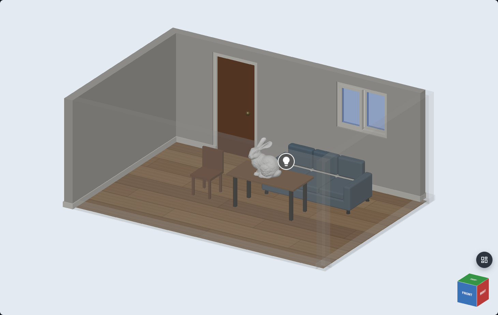 |  |

The finished screenshots use a visualization card with a shallow camera angle so you can see through the nearest walls. To set one up on your dashboard, see [Configure visualization cards](MANUAL.md#configure-visualization-cards).

To change how the room looks, click **Space configuration** (gear). For example, turn **Sky enabled** off under **Appearance** and choose a **Background color** to give the room a solid background. **Daylight conditions** controls the ambient light and sun.

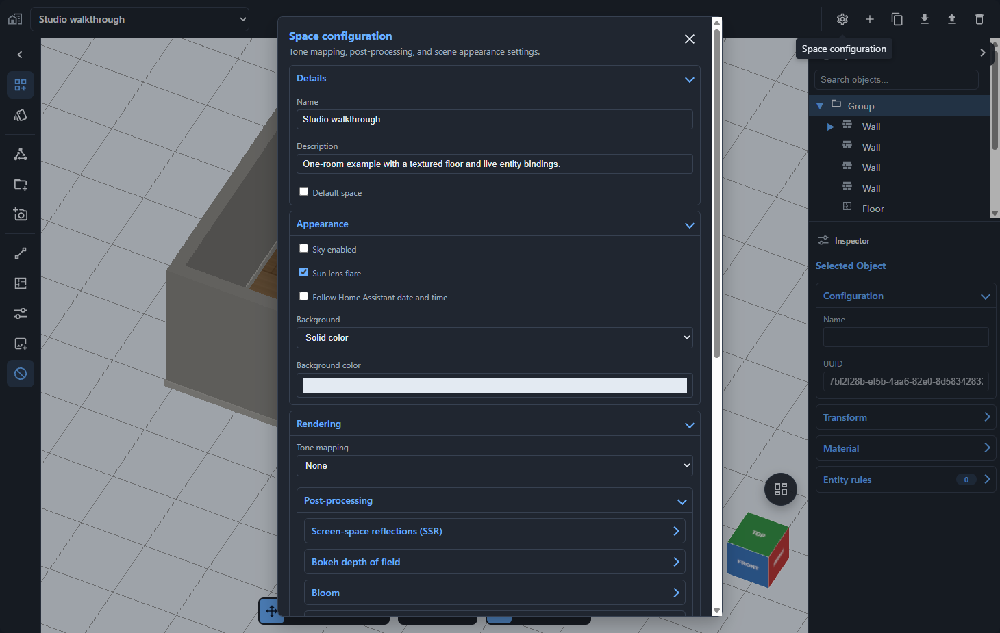

Wait for synchronization to finish before switching spaces. Use **Download space (.dt3d)** in the top bar to keep a portable copy with the geometry and textures. **Upload space (.dt3d)** opens a new copy of an archive. Entity bindings still need their corresponding Home Assistant entities wherever you open the space.

## If something looks wrong

| Symptom | What to check |
| --- | --- |
| Closing the walls leaves the room without a floor | Check **Create floors automatically** under **Wall creation**. Check that the last point snapped to the first wall and that the wall centerlines form a closed loop. |
| A door or window will not place | Double-click the wall surface with the corresponding opening tool active. Check whether the object appeared beneath that wall in **Objects**. |
| An entity is missing or a binding does not respond | Check the exact entity ID and state in Home Assistant. For the chair, check that the rule is enabled and that the entity's main state is numeric. |
| The floor texture lands on another object | Undo the assignment, switch to a top view, and drop the material onto an uncovered area of the floor. |
| The imported model is hard to see | Select it in **Objects** and choose **Focus selected objects**. Check **Transform → Scale** and adjust its height after resizing. |

See the [DT3D feature reference](MANUAL.md) for additional furniture families, grid and measurement details, entity rule actions, viewports, card configuration, and synchronization.
